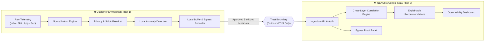

# NEXORA — Autonomous AIOps Observability Platform

> **Tagline:** See Every Signal. Secure Every Insight.  
> **Hackathon:** CICADA 2K26  
> **Phase:** Phase 2 — Architecture Design & Technical Methodology  
> **Status:** `[PROPOSED]` — Greenfield Architectural Specification  

---

## Problem Statement

> *"End-to-end, secure AIOps observability delivering autonomous insights across enterprise, data center, cloud, and distributed architectures."*

---

## Core Design Principle

> [!IMPORTANT]
> **Raw telemetry stays inside the customer's environment by default. Only explicitly approved, privacy-filtered metadata is transmitted to the centralized platform.**

Conventional centralized observability mandates streaming raw logs, system traces, and metrics directly to external cloud hosts, inevitably exposing sensitive operational secrets, PII, and internal network topologies. NEXORA establishes a privacy-first, two-tier architecture where **Tier 1 (Local Collector)** normalizes, filters, allow-lists, and locally evaluates telemetry inside the customer's network perimeter, while **Tier 2 (Centralized SaaS)** ingests only provably sanitized metadata for cross-layer correlation and explainable incident intelligence. Every outbound transmission is verifiably auditable via the **Egress Proof Panel**.

---

## Documentation Index

The technical documentation for Phase 2 is organized into four core architectural specifications:

| Document | Primary Focus | Key Contents |
|---|---|---|
| **[System Architecture](docs/ARCHITECTURE.md)** | Two-tier system topology & components | Two-tier model, 13 detailed component specifications, complete data flow lifecycle, Egress Proof architecture (Stages A–E), security, reliability, deployment models, and proposed technology stack. |
| **[Engineering Methodology](docs/METHODOLOGY.md)** | Analytical & operational pipeline | 5-stage pipeline (`OBSERVE → DETECT → CORRELATE → RECOMMEND → ACT`), 4 telemetry sources, 10-step data preprocessing, 4 proposed anomaly detection algorithms, cross-layer correlation, health evaluation, validation suite (12 test scenarios), and performance targets. |
| **[Architecture Decisions (ADR)](docs/ARCHITECTURE_DECISIONS.md)** | Design choices, trade-offs & rationales | 10 formal Architecture Decision Records covering two-tier boundary, strict allow-listing, local anomaly detection, local buffering/resilience, egress proof, cross-layer correlation, explainability, human-in-the-loop approval, fail-closed privacy, and normalization. |
| **[Security Threat Model](docs/THREAT_MODEL.md)** | Security analysis & threat mitigations | Threat model covering assets, 4 trust boundary zones, 6 threat actors, 9 attack surfaces, comprehensive Threat Table (15 threats: T-001 through T-015 with proposed mitigations and validation criteria), and residual risks. |

---

## System Overview Diagram

---

## Implementation Status

- **Status:** Architecture & Technical Specification (`Phase 2`)
- **Codebase:** Greenfield project specification; all architectural components, machine learning models, and security controls are marked **`[PROPOSED]`** pending implementation and validation.
