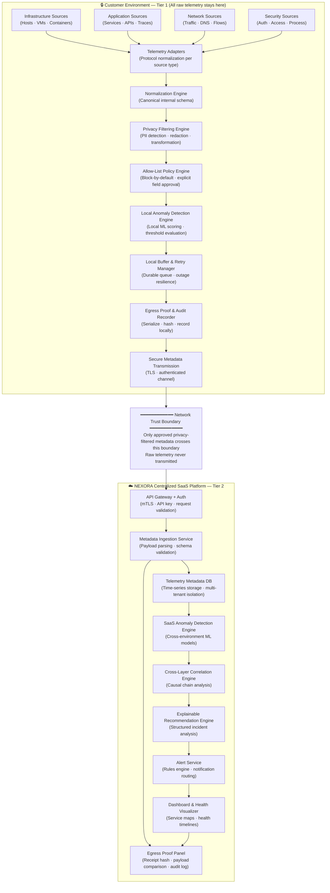
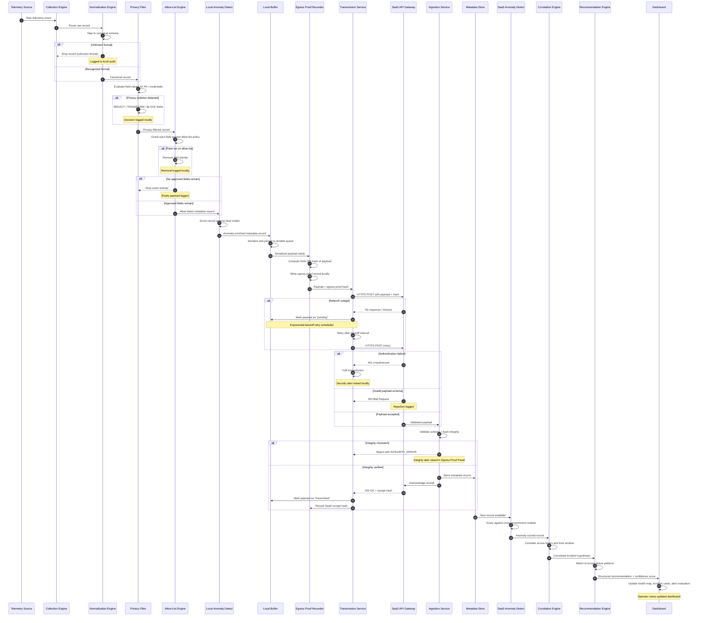
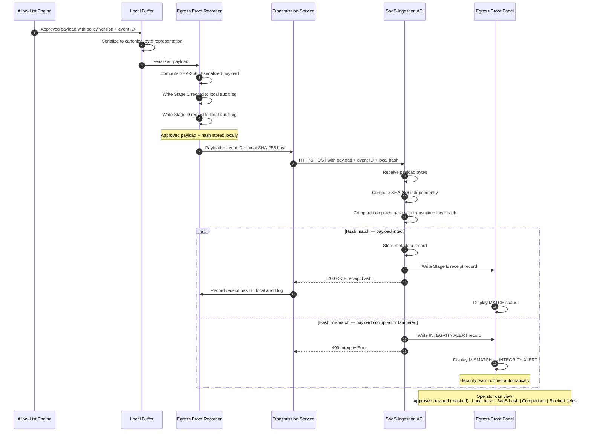
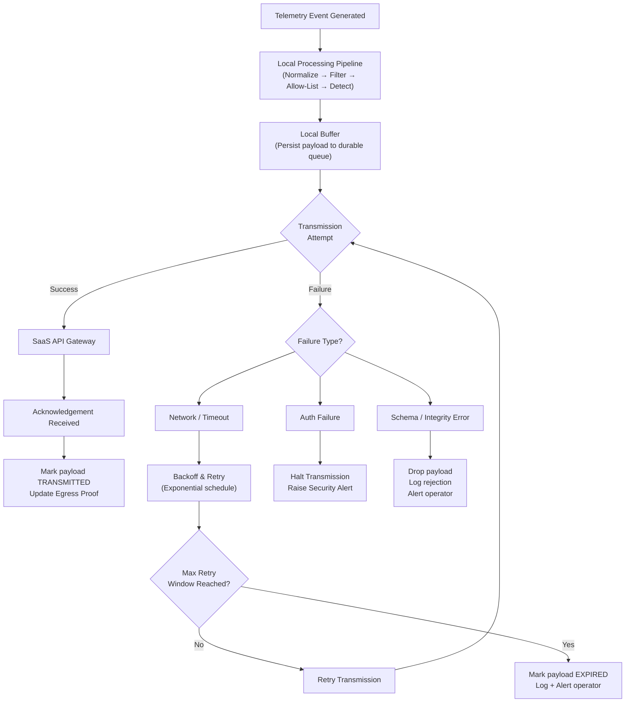
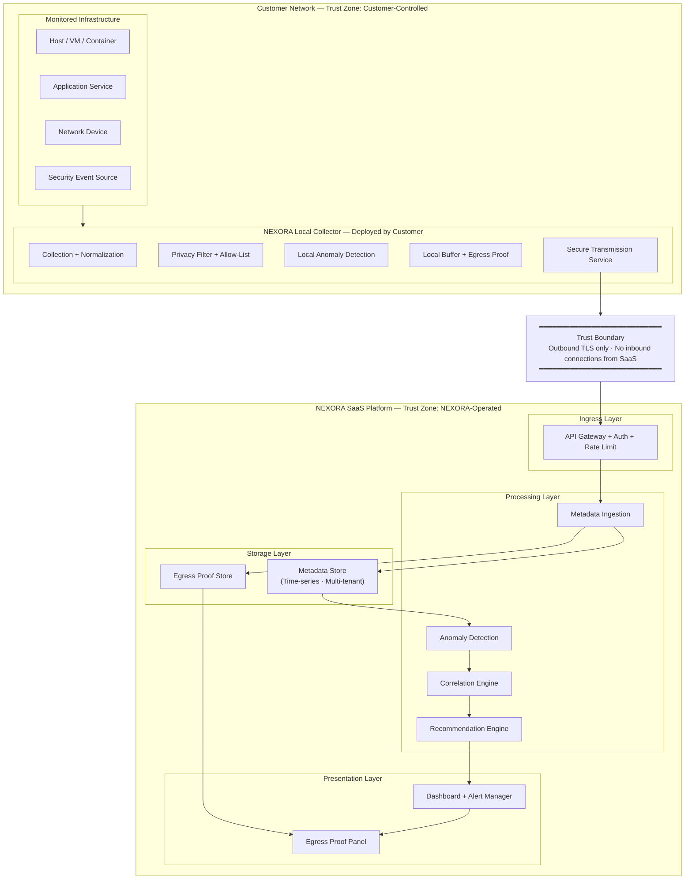

# NEXORA — Architecture Document

> **Document Status:** `[PROPOSED]` — Greenfield design for the CICADA 2K26 Hackathon.
> No production code exists. All components, technologies, and behaviors described herein are
> design proposals subject to revision during implementation.

**Version:** 0.1.0-draft
**Last Updated:** 2026-11-20
**Related Documents:**
- [METHODOLOGY.md](METHODOLOGY.md)
- [ARCHITECTURE_DECISIONS.md](ARCHITECTURE_DECISIONS.md)
- [THREAT_MODEL.md](THREAT_MODEL.md)

---

## Table of Contents

1. [Introduction](#1-introduction)
2. [Architecture Overview](#2-architecture-overview)
3. [High-Level Architecture Diagram](#3-high-level-architecture-diagram)
4. [Component-Level Architecture](#4-component-level-architecture)
5. [Data Flow Architecture](#5-data-flow-architecture)
6. [Egress Proof Architecture](#6-egress-proof-architecture)
7. [Security Architecture](#7-security-architecture)
8. [Reliability and Scalability Architecture](#8-reliability-and-scalability-architecture)
9. [Deployment Architecture](#9-deployment-architecture)
10. [Technology Stack](#10-technology-stack)
11. [Architecture Constraints and Trade-offs](#11-architecture-constraints-and-trade-offs)
12. [Quality Attributes](#12-quality-attributes)

---

## 1. Introduction

### 1.1 What is NEXORA?

NEXORA is a **[PROPOSED]** AIOps observability platform designed to monitor distributed, heterogeneous infrastructure environments. It applies machine-learning-driven anomaly detection, cross-layer telemetry correlation, and explainable AI recommendations to help engineering and security operations teams identify, understand, and resolve incidents faster than conventional rule-based monitoring systems permit.

NEXORA is designed from the ground up for environments where the operational boundary between a customer's private infrastructure and an external SaaS platform must be precisely controlled. This is not a secondary concern — it is a **first-class architectural constraint** that determines how every component is structured.

### 1.2 The Problem NEXORA Solves

Modern distributed systems generate enormous volumes of telemetry across multiple infrastructure layers simultaneously:

- **Infrastructure layer** — host metrics (CPU, memory, disk I/O, network I/O), hardware health signals, hypervisor and VM statistics.
- **Application layer** — service-level metrics, error rates, request latencies, trace spans, structured log events.
- **Network layer** — traffic volume, protocol distribution, latency between services, connection state, DNS resolution outcomes.
- **Security layer** — authentication events, authorization decisions, anomalous access patterns, process behavior, file integrity signals.

Operating teams face three interrelated problems:

**Problem 1 — Signal volume and noise.** The raw telemetry volume at scale is too large for humans to review manually. Conventional threshold-based alerting generates alert fatigue and misses correlated multi-layer failure modes.

**Problem 2 — Cross-layer causality.** Many production incidents manifest as a cascade across layers: a network degradation causes application latency, which triggers retry storms, which cause CPU saturation, which trips memory limits, which causes cascading failures. No single-layer monitoring tool can see this causal chain without telemetry correlation across all layers.

**Problem 3 — Privacy and security in centralized observability.** Conventional centralized observability platforms require shipping raw telemetry — including log lines, trace payloads, and metric labels — directly to an external system. This creates significant risks:

- Raw log lines may contain personally identifiable information (PII), credentials, session tokens, or business-sensitive data.
- Shipping raw telemetry gives the SaaS provider unrestricted access to operational intelligence about the customer's internal infrastructure topology.
- Once data leaves the customer's environment, the customer has no technical control over what was transmitted, no verifiable record of what the platform received, and no mechanism for independent audit.
- Regulatory frameworks (GDPR, HIPAA, SOC 2, PCI-DSS) place strict requirements on where sensitive operational data may be processed and stored.

### 1.3 The Core Design Principle

> [!IMPORTANT]
> **NEXORA's fundamental privacy guarantee:**
> Raw telemetry stays inside the customer's environment. Only explicitly approved, privacy-filtered metadata is transmitted to the centralized platform. Every egress event is recorded locally with a verifiable audit trail.

This principle has the following implications for the architecture:

1. **Local-first processing.** All normalization, privacy filtering, allow-list enforcement, and local anomaly detection happen inside the customer's network, on infrastructure the customer controls.
2. **Explicit allowance, not implicit exclusion.** Fields not on the approved allow-list are blocked by default. No opt-out model. No "exclude sensitive fields" lists. If a field is not explicitly approved, it does not leave.
3. **Verifiable egress.** Every approved outgoing payload is serialized, cryptographically hashed, and recorded locally before transmission. The SaaS platform records an independent receipt hash. The Egress Proof Panel allows operators to compare these records and verify that what was sent matches what was received — and that nothing else was included.
4. **Fail-closed privacy.** If the privacy filter or allow-list engine encounters an error, telemetry is blocked from transmission, not passed through. Availability of the SaaS platform is never permitted to override privacy controls.

### 1.4 Intended Users

| Persona | Primary Use |
|---|---|
| Site Reliability Engineers | Incident detection, root cause analysis, service health visibility |
| Security Operations Engineers | Security event correlation, anomaly investigation |
| Platform Engineers | Infrastructure health monitoring, capacity signals |
| Engineering Managers | System health dashboards, SLA awareness |
| Compliance Officers | Egress audit review, data minimization verification |

---

## 2. Architecture Overview

NEXORA is structured as a **two-tier architecture**: a **Customer Environment Tier** that runs entirely within the customer's own infrastructure, and a **Centralized SaaS Platform Tier** operated by NEXORA. These two tiers communicate exclusively through a narrow, authenticated, encrypted, and audited egress channel.

> [!NOTE]
> The word "metadata" in NEXORA's context means privacy-filtered, allow-listed, minimized signals derived from raw telemetry — not raw telemetry itself. The distinction is architectural and must be maintained consistently throughout all documentation and implementation.

---

### 2.1 Tier 1 — Customer Environment

The customer environment tier is a software collection of services deployed on infrastructure owned and operated by the customer. It performs all sensitive data handling locally.

| Responsibility | Description |
|---|---|
| Telemetry collection | Collects raw telemetry from infrastructure, application, network, and security sources via adapters |
| Normalization | Converts heterogeneous source formats into a canonical internal schema |
| Privacy filtering | Detects and redacts, transforms, or blocks privacy-sensitive field values |
| Allow-list enforcement | Blocks all fields not on the operator-approved allow-list |
| Local anomaly detection | Performs local ML-based anomaly scoring before any data leaves the environment |
| Local buffering | Persists approved payloads in a local durable queue during network outages |
| Egress audit | Records the approved serialized payload, its hash, and transmission status for every egress event |
| Secure transmission | Transmits only approved, filtered metadata to the SaaS platform over an encrypted channel |

**What stays local:** Raw telemetry values, raw log lines, unapproved fields, full metric label sets, trace payloads, any value not on the allow-list.

**What may be transmitted:** Explicitly allowed, privacy-filtered fields such as aggregated metric values, anonymized event types, anomaly scores, component health signals, and approved categorical labels.

---

### 2.2 Tier 2 — Centralized SaaS Platform

The SaaS platform tier receives, stores, and analyzes only the approved metadata payloads transmitted from customer environments. It never contacts the customer's environment to pull data — data flows are exclusively customer-environment → SaaS.

| Responsibility | Description |
|---|---|
| Secure ingestion | Authenticates incoming transmission, validates payload structure and integrity |
| Metadata storage | Stores received metadata in a time-series-aware persistent store |
| Cross-layer correlation | Identifies causal relationships across infrastructure, application, network, and security signal streams |
| Anomaly detection | Performs SaaS-side detection using cross-customer and cross-environment pattern models |
| Explainable recommendations | Generates human-readable, structured incident analysis and remediation suggestions |
| Health visualization | Renders service, component, and environment health status |
| Alert management | Manages alerting rules, notification routing, and suppression policies |
| Egress proof visualization | Provides the Egress Proof Panel for operators to audit and verify egress events |

---

## 3. High-Level Architecture Diagram

> [!NOTE]
> The following diagram represents the **[PROPOSED]** high-level architecture. All components and connections are design proposals.



**Key architectural invariants visualized above:**

| Invariant | Description |
|---|---|
| Raw telemetry confinement | All four source types feed only into on-premises adapters — no direct path to SaaS |
| Sequential local processing | Privacy filtering precedes allow-list enforcement; both precede egress |
| Fail-closed position | Buffer and audit recorder sit between local detection and transmission |
| Single egress point | All outbound data passes through a single authenticated transmission service |
| SaaS receipt audit | Every ingested payload is independently recorded in the Egress Proof Panel |

---

## 4. Component-Level Architecture

> [!NOTE]
> Each component below is described using a standard template: **Purpose, Input, Processing, Output, Dependencies, Security Responsibilities, Failure Handling.** All components are **[PROPOSED]**.

---

### 4.1 Telemetry Collection Engine

**Purpose:** Acts as the primary interface between NEXORA's local collector and all telemetry sources in the customer environment. It manages adapter lifecycle, source discovery, collection scheduling, and raw telemetry routing.

| Attribute | Detail |
|---|---|
| **Input** | Raw telemetry from infrastructure agents, application SDKs, network flow exporters, security event streams, and SNMP/WMI/syslog/StatsD endpoints |
| **Processing** | Maintains per-source adapters; polls or receives push events; performs source-level rate limiting; routes raw telemetry internally to the normalization pipeline |
| **Output** | Raw, source-typed telemetry records delivered to the Telemetry Normalization Engine |
| **Dependencies** | Infrastructure agents (e.g., node exporters, app instrumentation), network exporters, security event log sources |
| **Security Responsibilities** | Authenticates to monitored sources using local credentials; never exposes source credentials externally; isolates collection buffers per source type to prevent cross-contamination |
| **Failure Handling** | Source unavailability: logs locally, skips cycle, retries on next interval; adapter crash: restarts adapter without affecting other collection channels; backpressure: applies per-source rate limiting |

---

### 4.2 Telemetry Normalization Engine

**Purpose:** Converts raw, heterogeneous telemetry from multiple source formats and protocols into a canonical internal schema that all downstream components can process uniformly, without needing to understand source-specific structures.

| Attribute | Detail |
|---|---|
| **Input** | Raw source-typed records from the Telemetry Collection Engine |
| **Processing** | Maps source-specific field names to canonical schema fields; converts units (e.g., bytes to KB, nanoseconds to milliseconds); parses timestamps into a unified format; assigns telemetry layer classification (infrastructure / application / network / security) |
| **Output** | Canonical telemetry records with standardized field names, types, units, and layer classification |
| **Dependencies** | Telemetry Collection Engine; schema definition registry |
| **Security Responsibilities** | Does not evaluate field values; does not make privacy decisions; outputs are passed to Privacy Filtering Engine before any further processing |
| **Failure Handling** | Unknown source format: logs as unrecognized, drops record, does not forward; schema version mismatch: routes to dead-letter queue for operator inspection |

---

### 4.3 Privacy Filtering Engine

**Purpose:** Detects and neutralizes privacy-sensitive content in normalized telemetry field values before any allow-list evaluation or egress. This component is the first of two privacy-enforcement layers.

| Attribute | Detail |
|---|---|
| **Input** | Canonical telemetry records from the Normalization Engine |
| **Processing** | Evaluates field values against a library of privacy detection patterns (PII patterns, credential patterns, free-text field heuristics); applies one of four decisions per field: **PASS** (non-sensitive, forward as-is), **REDACT** (replace value with a category token such as `[REDACTED:EMAIL]`), **TRANSFORM** (apply a deterministic privacy-preserving transformation), **BLOCK** (remove field entirely from the record) |
| **Output** | Privacy-filtered canonical records where no field value contains known-sensitive content |
| **Dependencies** | Normalization Engine; privacy pattern library (operator-managed) |
| **Security Responsibilities** | Fail-closed: on any processing error, blocks the entire record from proceeding rather than passing it through; logs every BLOCK and REDACT decision to the local audit log |
| **Failure Handling** | Pattern library unavailable: blocks all records from proceeding (fail-closed); processing error on a single record: drops record, logs error, does not propagate |

> [!WARNING]
> Privacy filtering is not infallible. It operates on heuristic patterns. Operators must review the pattern library regularly and must not assume that "no detection" means "no sensitive content." The Allow-List Policy Engine provides a second enforcement layer.

---

### 4.4 Strict Allow-List Policy Engine

**Purpose:** Enforces the definitive field-level egress policy. Only fields explicitly named on the operator-approved allow-list may proceed to downstream transmission. This is the second and final privacy-enforcement layer.

| Attribute | Detail |
|---|---|
| **Input** | Privacy-filtered canonical records from the Privacy Filtering Engine |
| **Processing** | For each record field: checks whether the field name appears in the active allow-list policy; if present, passes field to the outgoing payload; if absent, removes field silently; if the resulting payload has no approved fields, the entire event is dropped |
| **Output** | Allow-listed metadata records containing only explicitly approved fields; policy version and event ID are attached to each record |
| **Dependencies** | Privacy Filtering Engine; allow-list policy store (operator-managed, version-controlled) |
| **Security Responsibilities** | Allow-list policy is immutable once deployed; policy changes require versioned re-deployment; engine logs every field removal and every empty-payload drop to the local audit trail |
| **Failure Handling** | Policy unavailable: fail-closed, all records blocked; policy version conflict: blocks affected records, alerts operator; engine error: fail-closed |

> [!IMPORTANT]
> The Allow-List Policy Engine uses a **default-deny** model. The absence of a field from the allow-list is a block, not a pass. This design ensures that newly introduced telemetry fields — added by application updates or agent upgrades — cannot silently escape the environment.

---

### 4.5 Local Anomaly Detection Engine

**Purpose:** Performs anomaly scoring on approved, filtered metadata locally — before transmission — so that anomaly signals are available even when the SaaS platform is unreachable. Local detection also reduces dependency on the central platform for time-critical operational decisions.

| Attribute | Detail |
|---|---|
| **Input** | Allow-listed metadata records from the Allow-List Policy Engine |
| **Processing** | Maintains per-metric and per-component statistical models trained on local history; scores each incoming record against baseline patterns; attaches an anomaly score and a signal classification (normal / warning / critical) to each record; updates local models incrementally |
| **Output** | Metadata records enriched with local anomaly score, signal classification, and contributing feature set |
| **Dependencies** | Allow-List Policy Engine; local model store (file system); local historical buffer |
| **Security Responsibilities** | Model files are stored in a protected local directory; model outputs are appended to records but do not override or modify approved field values |
| **Failure Handling** | Model unavailable or corrupted: passes records through without anomaly enrichment; flags records as "unscored" in the payload; logs model failure locally |

---

### 4.6 Local Buffer and Retry Manager

**Purpose:** Provides durability for the egress pipeline. Approved, enriched metadata payloads are persisted in a local durable queue before transmission, ensuring that network outages or SaaS unavailability do not cause data loss.

| Attribute | Detail |
|---|---|
| **Input** | Anomaly-enriched metadata records from the Local Anomaly Detection Engine |
| **Processing** | Serializes each record into the outgoing payload format; writes to a durable local queue; tracks transmission status per record; implements retry scheduling with exponential backoff; enforces a configurable maximum retention window and maximum queue depth |
| **Output** | Serialized payloads ready for the Egress Proof & Audit Recorder |
| **Dependencies** | Local Anomaly Detection Engine; local persistent storage (e.g., Redis or disk-backed queue) |
| **Security Responsibilities** | Buffer contents are stored encrypted at rest (proposed); buffer files are accessible only to the collector service account |
| **Failure Handling** | Queue full: drops oldest records (configurable) or blocks new ingestion; storage failure: logs error, signals operator; on recovery, resumes from last committed offset |

---

### 4.7 Secure Metadata Transmission Service

**Purpose:** Manages the outbound authenticated encrypted channel between the customer environment and the NEXORA SaaS platform. Transmits only pre-approved, pre-audited payloads.

| Attribute | Detail |
|---|---|
| **Input** | Egress-audited payloads from the Egress Proof & Audit Recorder |
| **Processing** | Establishes and maintains a TLS connection to the SaaS Metadata Ingestion API; authenticates using a customer-specific credential (proposed: mTLS client certificate or API key); transmits payloads; receives acknowledgement from the SaaS platform; updates transmission status in the local buffer; handles connection failures and retry scheduling |
| **Output** | Transmission status (success / failure / pending) written back to the Local Buffer and Retry Manager; transmission record written to the local egress audit log |
| **Dependencies** | Egress Proof & Audit Recorder; Local Buffer and Retry Manager; SaaS Metadata Ingestion API |
| **Security Responsibilities** | Enforces TLS minimum version and cipher suite (proposed); validates SaaS server certificate; never transmits over an unencrypted connection; on authentication failure, blocks further transmission and alerts locally |
| **Failure Handling** | Connection failure: exponential backoff retry; authentication failure: halt transmission, alert, log; partial send: marks record as "pending" until SaaS acknowledgement received |

---

### 4.8 Metadata Ingestion API

**Purpose:** The SaaS-side entry point for all inbound customer metadata payloads. Handles authentication, rate limiting, schema validation, and routing to storage.

| Attribute | Detail |
|---|---|
| **Input** | Authenticated HTTPS requests from customer environment Secure Metadata Transmission Services |
| **Processing** | Verifies customer authentication credential; validates payload schema; validates event ID uniqueness (deduplication); validates payload integrity (hash comparison with approved hash transmitted in egress proof record); routes validated payload to Metadata Storage; routes egress proof record to Egress Proof Panel |
| **Output** | Stored metadata records; Egress Proof Panel receipt records; acknowledgement response to the transmitting collector |
| **Dependencies** | API Gateway; Metadata Storage; Egress Proof Panel; customer credential registry |
| **Security Responsibilities** | Enforces TLS; validates all input before storage; enforces per-customer rate limits; rejects payloads that fail schema or integrity validation; logs all ingestion events including rejections |
| **Failure Handling** | Invalid payload: reject with error code, log, do not store; auth failure: reject, log, alert; storage unavailable: return transient error to trigger collector retry; deduplication: silently discard duplicate event IDs |

---

### 4.9 Cross-Layer Correlation Engine

**Purpose:** Identifies causal and temporal relationships between anomaly signals arriving from different telemetry layers (infrastructure, application, network, security) across time windows. This is a core intelligence component of the SaaS platform.

| Attribute | Detail |
|---|---|
| **Input** | Anomaly-enriched metadata records from Metadata Storage; correlation configuration (time window, layer weighting) |
| **Processing** | Groups incoming signals by time window; correlates anomalies across layers using temporal proximity, causal graph analysis, and historical pattern matching; identifies multi-layer incident signatures; produces structured incident hypotheses ranked by confidence |
| **Output** | Correlated incident records delivered to the Recommendation Engine and Alert Service |
| **Dependencies** | Metadata Storage; SaaS Anomaly Detection Engine; historical correlation model store |
| **Security Responsibilities** | Enforces multi-tenant isolation — correlation never mixes signals from different customer environments; outputs are tagged with tenant identifier |
| **Failure Handling** | Missing layer data: produces partial correlation, flags missing layers; model failure: logs, produces rule-based fallback correlation |

---

### 4.10 Explainable Recommendation Engine

**Purpose:** Translates correlated incident hypotheses into human-readable, structured explanations that give operators not just an alert, but an actionable understanding of what happened, why, and what to do about it.

| Attribute | Detail |
|---|---|
| **Input** | Correlated incident records from the Cross-Layer Correlation Engine |
| **Processing** | Maps incident signatures to a knowledge base of known failure patterns; generates a structured explanation including: affected components, signal timeline, hypothesized root cause, contributing factors, recommended remediation steps (ranked by specificity and confidence); attaches a confidence score and an explanation provenance (which signals contributed) |
| **Output** | Structured recommendation records delivered to the Alert Service and Dashboard |
| **Dependencies** | Cross-Layer Correlation Engine; incident pattern knowledge base; recommendation template library |
| **Security Responsibilities** | Recommendations are scoped to the originating customer tenant; no cross-tenant signal leakage |
| **Failure Handling** | Unknown incident pattern: produces a "No known pattern matched" recommendation with raw signal summary; knowledge base unavailable: produces raw correlation output without narrative enrichment |

---

### 4.11 Health Status Evaluator

**Purpose:** Maintains a continuously updated health state for each monitored component, service, and environment. Provides the authoritative health signal consumed by the Dashboard and Alert Manager.

| Attribute | Detail |
|---|---|
| **Input** | Metadata records from Metadata Storage; anomaly scores from SaaS Anomaly Detection; heartbeat signals from local collectors |
| **Processing** | Evaluates current and historical signal windows for each tracked component; computes a health state (healthy / degraded / critical / unknown); tracks health state transitions; raises state-change events |
| **Output** | Health state records per component; state-change events delivered to the Alert Service |
| **Dependencies** | Metadata Storage; SaaS Anomaly Detection Engine; collector heartbeat stream |
| **Security Responsibilities** | Multi-tenant isolation; health states are scoped per customer |
| **Failure Handling** | No signal received within heartbeat window: transitions component to "unknown" state; triggers operator notification |

---

### 4.12 Egress Proof Panel

**Purpose:** Provides the operator-facing audit interface for verifying that what was transmitted from the customer environment matches what the SaaS platform received — and that nothing beyond the approved payload was included.

| Attribute | Detail |
|---|---|
| **Input** | Egress proof records from the Local Egress Audit Recorder (via Metadata Ingestion API); SaaS receipt records |
| **Processing** | For each egress event: displays the approved serialized payload (with locally sensitive values masked); displays the local SHA-256 hash; displays the SaaS receipt hash; computes and displays comparison result (match / mismatch); displays transmission status and timestamp; supports filtering and search by event ID, time range, component, and status |
| **Output** | Rendered audit interface; exportable egress audit reports |
| **Dependencies** | Metadata Ingestion API; Egress Proof record store |
| **Security Responsibilities** | Access to Egress Proof Panel is role-restricted; raw field values that were blocked locally are never shown — only redacted representations; mismatch events trigger automatic alerts to the security operations team |
| **Failure Handling** | Missing SaaS receipt: displays "receipt pending" status; hash mismatch: flags as "INTEGRITY ALERT" and triggers security notification |

---

### 4.13 Dashboard and Alert Manager

**Purpose:** The primary operational interface. Provides real-time and historical health visibility, incident tracking, alert configuration, and notification routing.

| Attribute | Detail |
|---|---|
| **Input** | Health state records; correlated incident records; structured recommendations; alert rule configurations; notification destination configurations |
| **Processing** | Renders service and infrastructure health maps; displays active incident cards with recommendations; evaluates alert rules against health state changes; routes notifications to configured destinations (email, webhook, PagerDuty, etc.); manages alert suppression and escalation policies |
| **Output** | Web UI views; outbound notification events |
| **Dependencies** | Health Status Evaluator; Explainable Recommendation Engine; Alert Service; notification integrations |
| **Security Responsibilities** | RBAC-enforced view scoping; users see only the customer environments they are authorized for; alert notification destinations are audited |
| **Failure Handling** | Recommendation service unavailable: displays raw correlation data with "analysis pending" indicator; notification delivery failure: retries and logs; alert rule evaluation failure: logs and raises platform health alert |

---

## 5. Data Flow Architecture

> [!NOTE]
> The following sequence diagram represents the **[PROPOSED]** full telemetry lifecycle — from raw generation in the customer environment through SaaS ingestion, analysis, and dashboard display. Failure branches are included.



---

## 6. Egress Proof Architecture

The Egress Proof system is a core NEXORA differentiator. It provides operators and compliance teams with a verifiable, end-to-end audit trail for every piece of data that leaves the customer environment. This section describes the five stages of the egress proof lifecycle.

> [!IMPORTANT]
> **A cryptographic hash alone does not prove what was transmitted.** A hash proves only that a specific byte sequence was present at a specific time. Without retaining the actual approved serialized payload alongside the hash, it is impossible to verify what fields and values were included in the transmission. NEXORA's Egress Proof design retains the approved serialized payload locally, allowing meaningful payload-level comparison — not just hash comparison.

---

### 6.1 Stage A — Local Raw Telemetry

The raw telemetry record as received by the Normalization Engine. This record is **never transmitted** and is not stored long-term. It is retained transiently for processing only.

- Contains all original field names and values, including those that will be blocked.
- Sensitive values are **masked in any UI rendering** (they are never displayed, only their category labels are shown: e.g., `[RAW:MASKED]`).
- Provides the "before" baseline for understanding what privacy filtering and allow-listing removed.

---

### 6.2 Stage B — Privacy Decision Record

Generated by the Privacy Filtering Engine and Allow-List Policy Engine. Records the disposition of every field in the raw record.

- For each field: records whether it was **PASSED**, **REDACTED**, **TRANSFORMED**, or **BLOCKED**.
- Records the allow-list policy version in effect at the time of evaluation.
- Records the timestamp and event ID.
- This record is stored in the **local** egress audit log. It is not transmitted to the SaaS platform.

---

### 6.3 Stage C — Approved Payload

The serialized outgoing payload that has passed both the Privacy Filter and the Allow-List Policy Engine.

- Contains only approved field names and values.
- Includes attached metadata: policy version, event ID, local timestamp, collector identifier.
- Serialized to a canonical byte representation (order-stable, deterministic serialization).
- This is the exact byte sequence that will be transmitted.

**Synthetic example of an approved payload structure (illustrative only):**

```json
{
  "event_id": "a3f7c291-0012-4e88-b92a-000000000001",
  "collector_id": "collector-prod-eu-west-01",
  "policy_version": "v2.4.1",
  "timestamp_utc": "2026-11-20T16:00:00.000Z",
  "telemetry_layer": "infrastructure",
  "component": "web-tier",
  "anomaly_score": 0.73,
  "signal_class": "warning",
  "cpu_utilization_pct": 87.4,
  "memory_utilization_pct": 91.2,
  "health_state": "degraded"
}
```

> [!NOTE]
> This is a synthetic illustrative example. The actual allowed fields are determined by the customer's deployed allow-list policy. No specific schema is mandated by this document.

---

### 6.4 Stage D — Transmission Evidence

Generated by the Egress Proof & Audit Recorder immediately before transmission.

- **SHA-256 hash** of the canonical serialized payload (Stage C).
- **Transmission timestamp** (attempted).
- **Transmission status** (pending / success / failed).
- Stored locally in the egress audit log.
- The hash and event ID are transmitted alongside the payload to the SaaS platform.

---

### 6.5 Stage E — SaaS Receipt

Generated by the SaaS Metadata Ingestion API upon successful receipt and validation.

- **Receipt timestamp** (server-side).
- **SHA-256 hash** of the payload as received by the SaaS platform, computed independently.
- **Comparison result**: the SaaS platform compares its independently computed hash with the hash transmitted in Stage D. A match indicates the payload arrived intact.
- Both the local hash (Stage D) and the SaaS receipt hash (Stage E) are displayed in the **Egress Proof Panel**, allowing the operator to perform their own independent comparison.

---

### 6.6 Egress Proof Panel — Section Reference

| Panel Section | Content | Source |
|---|---|---|
| Event ID | Unique identifier for this egress event | Local (Stage C) |
| Telemetry Layer | infrastructure / application / network / security | Local (Stage C) |
| Component | Monitored component identifier | Local (Stage C) |
| Policy Version | Allow-list policy version applied | Local (Stage B, C) |
| Local Timestamp | Time of egress proof record creation | Local (Stage D) |
| Approved Payload | Serialized payload content (sensitive values masked in UI) | Local (Stage C) |
| Local SHA-256 Hash | Hash of approved payload computed before transmission | Local (Stage D) |
| Transmission Status | pending / transmitted / failed | Local (Stage D) |
| SaaS Receipt Timestamp | Time the SaaS platform received the payload | SaaS (Stage E) |
| SaaS Receipt Hash | Hash of payload as received, computed by SaaS independently | SaaS (Stage E) |
| Comparison Result | MATCH / MISMATCH / PENDING | Computed (Stage E) |
| Privacy Decision Summary | Count of PASSED / REDACTED / TRANSFORMED / BLOCKED fields | Local (Stage B) |
| Fields Blocked | Names of fields removed (values never shown) | Local (Stage B) |

---

### 6.7 Egress Proof Workflow — Sequence Diagram



---

## 7. Security Architecture

> [!WARNING]
> All security controls described in this section are **[PROPOSED]** design goals. No controls have been implemented. This section documents the intended security architecture to be validated and implemented during development. See [THREAT_MODEL.md](THREAT_MODEL.md) for the full threat model.

---

### 7.1 Data Minimization `[PROPOSED]`

NEXORA's privacy model is built on data minimization as a first principle. The system is designed to transmit the smallest possible set of fields necessary to support SaaS-side analysis. Data minimization is enforced structurally through the two-layer privacy pipeline (Privacy Filtering Engine + Allow-List Policy Engine) rather than through operator discipline alone.

### 7.2 Strict Allow-Listing `[PROPOSED]`

The Allow-List Policy Engine enforces a default-deny field-level policy. The allow-list is:
- Version-controlled and auditable.
- Deployed explicitly by a privileged operator role.
- Cannot be bypassed by application-layer updates or telemetry source changes.
- Recorded in every egress proof record so that any change in what fields are transmitted is traceable.

### 7.3 Encryption in Transit `[PROPOSED]`

All data transmitted between the customer environment and the SaaS platform is proposed to be encrypted using TLS (minimum version TBD during design). The design intends to evaluate mutual TLS (mTLS) for enhanced client-side authentication. No plaintext channel is permitted.

### 7.4 Authentication `[PROPOSED]`

Customer environments authenticate to the SaaS Metadata Ingestion API using a credential mechanism to be determined during detailed design (proposed candidates: mTLS client certificate, API key with HMAC signing). The SaaS API Gateway validates credentials on every request. Invalid credentials result in rejection and logging.

### 7.5 Role-Based Access Control `[PROPOSED]`

The SaaS platform proposes RBAC for all user-facing interfaces. Access to the Egress Proof Panel, alert configuration, and customer environment data is restricted by role. Cross-tenant access is prohibited at the data model level, not just the UI level.

### 7.6 Secret Management `[PROPOSED]`

Collector credentials, API keys, and TLS private keys are proposed to be stored in a secrets management system (not in environment variables or configuration files). The specific system (e.g., HashiCorp Vault, cloud-provider secret manager) is TBD during deployment design.

### 7.7 Secure Configuration `[PROPOSED]`

Collector configuration, allow-list policies, and privacy pattern libraries are proposed to be:
- Stored in version-controlled, operator-signed configuration files.
- Validated on startup before any collection begins.
- Immutable at runtime (reload requires explicit operator action).

### 7.8 Audit Logging `[PROPOSED]`

All privacy decisions (REDACT, BLOCK, TRANSFORM), all allow-list field removals, all egress events, all transmission failures, and all authentication events are proposed to be written to a tamper-evident local audit log. The SaaS platform similarly logs all ingestion events, rejections, and integrity alerts.

### 7.9 Input Validation `[PROPOSED]`

The SaaS Metadata Ingestion API proposes to validate all inbound payloads against a strict schema before storage. Fields not in the expected schema are rejected. Payload size limits are enforced. All validation rejections are logged.

### 7.10 Network Boundary Protection `[PROPOSED]`

The local collector is proposed to operate with outbound-only network access to the SaaS API endpoint. No inbound connections from the SaaS platform to the customer environment are permitted. The SaaS platform does not have the ability to initiate connections into customer environments.

### 7.11 Fail-Closed Privacy Behavior `[PROPOSED]`

If the Privacy Filtering Engine, Allow-List Policy Engine, or Egress Proof Recorder encounters a processing error or is unavailable, the design requires that telemetry is blocked from transmission rather than passed through. SaaS platform availability must never take precedence over privacy controls.

---

## 8. Reliability and Scalability Architecture

> [!NOTE]
> All reliability and scalability mechanisms described here are **[PROPOSED]** design goals.

---

### 8.1 Local Buffering

The Local Buffer and Retry Manager provides a durable queue between the local processing pipeline and the transmission service. Payloads are persisted to disk (or a local in-memory store with disk backing) before transmission is attempted. This ensures that:

- Short network outages do not cause data loss.
- SaaS platform maintenance windows do not interrupt local collection.
- Payloads are retransmitted automatically upon recovery.

### 8.2 Retry with Exponential Backoff

Transmission failures trigger a retry schedule with exponential backoff to avoid overwhelming the SaaS platform during partial outages. The backoff schedule is configurable. A maximum retry window is enforced to bound buffer growth.

### 8.3 Idempotent Ingestion and Duplicate Prevention

Each egress payload carries a unique event ID generated at the Local Buffer stage. The SaaS Metadata Ingestion API tracks received event IDs and silently discards duplicate submissions. This ensures that retransmission after a network failure does not produce duplicate records in the SaaS database.

### 8.4 Event Timestamps and Out-of-Order Handling

All metadata records carry the event timestamp from the originating telemetry source, not the ingestion timestamp. The SaaS Metadata Store is proposed to support out-of-order insertion with event-time semantics, allowing late-arriving records (from buffered retransmissions) to be placed correctly in the time-series rather than appended at current time.

### 8.5 Collector Heartbeat and Offline Detection

The local collector sends periodic heartbeat signals to the SaaS platform. The Health Status Evaluator tracks heartbeat receipt per collector. If a heartbeat is not received within the configured window, the affected environment's components transition to "unknown" health state and an operator notification is raised.

### 8.6 Reconnection and Recovery

On network recovery after an outage:
1. The Transmission Service re-establishes the TLS connection.
2. The Local Buffer replays buffered payloads in order.
3. The SaaS Ingestion API deduplicates using event IDs.
4. The Egress Proof Panel updates transmission status for replayed events.
5. The Health Status Evaluator processes late-arriving records and re-evaluates component health.

### 8.7 Horizontal SaaS Scaling `[PROPOSED]`

The SaaS platform components (Metadata Ingestion API, Anomaly Detection, Correlation Engine, Recommendation Engine) are proposed to be designed as stateless services that can be horizontally scaled. Shared state (metadata store, model store) is managed by the persistence layer rather than individual service instances.

### 8.8 Multi-Tenant Isolation `[PROPOSED]`

Customer data in the SaaS platform is proposed to be isolated at the data model level using tenant identifiers. Queries, correlation, and recommendation outputs are scoped to a single tenant. No cross-tenant data access is permitted, including during aggregated model training (which uses only tenant-local data, or aggregated/anonymized signals where explicitly designed).

---

### 8.9 Failure-Recovery Flow



---

## 9. Deployment Architecture

> [!NOTE]
> All deployment configurations described here are **[PROPOSED]**. NEXORA is designed to support multiple deployment patterns for the local collector tier.

---

### 9.1 Local Collector Deployment Options

| Deployment Model | Description |
|---|---|
| **On-premises bare metal / VM** | Collector installed as a systemd service or OS-managed daemon on a dedicated host within the customer's data center network |
| **On-premises containerized** | Collector deployed as a Docker container or Kubernetes DaemonSet within the customer's private container environment |
| **Private cloud** | Collector deployed in a customer-managed private cloud environment (e.g., OpenStack, VMware Cloud) using container or VM form factor |
| **Public cloud — customer VPC** | Collector deployed as a container or VM within the customer's own cloud VPC (AWS, GCP, Azure). Operates within the customer's network boundary; does not use the cloud provider's native monitoring pipeline |
| **Kubernetes native** | Collector deployed as a Kubernetes DaemonSet to collect telemetry from all nodes; a cluster-level aggregator collector handles Kubernetes API and control-plane signals |

### 9.2 Centralized SaaS Platform Deployment `[PROPOSED]`

The SaaS platform is proposed to be deployed as a multi-service containerized application managed by Kubernetes (or equivalent), operated by NEXORA. It is not deployed in the customer's environment.

| Characteristic | Proposal |
|---|---|
| Multi-tenancy | Tenant isolation at data model and namespace level |
| Availability | Multi-region or multi-zone deployment (specifics TBD) |
| Ingress | Single HTTPS API endpoint per region, behind a load balancer |
| Data residency | Region selection per customer (specifics TBD during detailed design) |

---

### 9.3 Deployment Diagram with Trust Boundaries



---

## 10. Technology Stack

> [!IMPORTANT]
> The entire technology stack listed below is **[PROPOSED]**. No technology has been selected, implemented, or tested. These are informed proposals based on the problem domain. Technology choices will be validated during the design and prototyping phases. See [ARCHITECTURE_DECISIONS.md](ARCHITECTURE_DECISIONS.md) for the rationale records for key choices.

---

### 10.1 Local Collector Tier

| Technology | Role | Rationale |
|---|---|---|
| **Python 3.11+** `[PROPOSED]` | Primary language for all collector components | Strong ecosystem for ML, data processing, and telemetry adapters; rapid prototyping capability appropriate for hackathon phase |
| **OpenTelemetry SDK** `[PROPOSED]` | Telemetry protocol and adapter foundation | Industry-standard observability instrumentation protocol; supports metrics, traces, and logs; broad source compatibility |
| **Prometheus client libraries** `[PROPOSED]` | Infrastructure metrics collection integration | Widely adopted in Kubernetes and cloud-native environments; pull-based metrics exposition standard |
| **Redis** `[PROPOSED]` | Local durable buffer for egress payloads | In-memory data store with persistence options; supports queue semantics, TTL, and fast throughput |
| **Docker** `[PROPOSED]` | Collector containerization | Portable deployment across on-premises, private cloud, and public cloud environments |
| **Kubernetes DaemonSet** `[PROPOSED]` | Kubernetes-native collector deployment pattern | Ensures collector runs on every node in a Kubernetes cluster |

### 10.2 Local ML — Anomaly Detection

| Technology | Role | Rationale |
|---|---|---|
| **scikit-learn or similar** `[PROPOSED]` | Local anomaly detection model training and inference | Lightweight, well-understood statistical and ML models suitable for local deployment without GPU requirement |
| **NumPy / Pandas** `[PROPOSED]` | Numerical processing and time-series manipulation | Standard scientific computing stack for Python; appropriate for metric window analysis |

### 10.3 SaaS Platform Tier

| Technology | Role | Rationale |
|---|---|---|
| **Python 3.11+** `[PROPOSED]` | Primary language for SaaS backend services | Consistency with collector tier; strong ML and data processing libraries |
| **FastAPI** `[PROPOSED]` | Metadata Ingestion API and internal service APIs | High-performance async Python web framework; native OpenAPI schema generation; appropriate for structured API services |
| **PostgreSQL with TimescaleDB extension** `[PROPOSED]` | Metadata storage with time-series capabilities | TimescaleDB extends PostgreSQL with native time-series hypertables and efficient time-window queries; relational model supports multi-tenant isolation |
| **Redis** `[PROPOSED]` | Caching, session management, inter-service message passing | Shared cache layer for SaaS services |
| **Kubernetes** `[PROPOSED]` | SaaS platform orchestration | Container orchestration for horizontally scaled services; namespace-level multi-tenant isolation |
| **Docker** `[PROPOSED]` | SaaS service containerization | Consistent build and deployment artifact format |

### 10.4 Security and Transport

| Technology | Role | Rationale |
|---|---|---|
| **TLS 1.2+ / mTLS** `[PROPOSED]` | Encryption and mutual authentication for the egress channel | Standard transport security; mTLS provides client-side authentication without additional credential overhead |
| **SHA-256** `[PROPOSED]` | Egress proof payload integrity hashing | Cryptographically strong hash function; well-supported in all target languages |
| **Secrets management system (TBD)** `[PROPOSED]` | Credential and key storage for collector and SaaS services | Specific platform (Vault, cloud-native secrets manager) to be selected based on deployment environment |

### 10.5 Observability of NEXORA Itself

| Technology | Role | Rationale |
|---|---|---|
| **Structured logging (JSON)** `[PROPOSED]` | Internal operational logging for all components | Machine-parseable logs for operational monitoring of the collector and SaaS services themselves |
| **Prometheus metrics (self-instrumentation)** `[PROPOSED]` | Metrics exposition for NEXORA collector health | Collector exposes its own operational metrics (queue depth, collection rate, error rate) |

---

## 11. Architecture Constraints and Trade-offs

> [!NOTE]
> This section documents known architectural tensions and the design decisions made to resolve them. Each trade-off has an associated decision record in [ARCHITECTURE_DECISIONS.md](ARCHITECTURE_DECISIONS.md).

---

### 11.1 Privacy vs. Centralized Visibility

**Tension:** Strong privacy controls — specifically the strict allow-list — reduce the richness of data available to the SaaS platform for analysis. The SaaS platform cannot compensate for data that was never transmitted.

**Resolution:** NEXORA accepts reduced SaaS-side analytical fidelity as a necessary cost of the privacy-first architecture. The local anomaly detection engine is designed to provide first-tier detection without SaaS visibility. The allow-list is designed to be configurable by operators who can deliberately expand it to increase analytical depth, subject to their own privacy requirements.

---

### 11.2 Local vs. SaaS Processing

**Tension:** Performing anomaly detection locally requires running ML models on customer infrastructure, consuming local resources. Deferring all detection to the SaaS platform would simplify the collector but would mean no detection during outages and would require more data to be transmitted.

**Resolution:** A two-tier detection model is proposed. Local detection handles time-critical signals and operates offline. SaaS detection handles cross-environment pattern recognition, which requires the centralized view.

---

### 11.3 Detection Accuracy vs. Overhead

**Tension:** More sophisticated local ML models produce more accurate anomaly scores but consume more CPU and memory on customer infrastructure.

**Resolution:** Local models are proposed to be lightweight statistical models (e.g., sliding-window z-score, isolation forest on reduced feature sets) designed for minimal resource footprint. More computationally intensive models are reserved for the SaaS tier where resources are centrally managed.

---

### 11.4 Security vs. Convenience

**Tension:** Strict TLS enforcement, credential validation, and fail-closed privacy behavior can make initial setup and debugging more operationally difficult. Developers may be tempted to disable security controls during testing.

**Resolution:** The architecture proposes no bypass mechanism for security controls. A dedicated development/sandbox deployment mode — with clearly labeled reduced-security configuration — is proposed for local development only, with explicit safeguards to prevent accidental use in production.

---

### 11.5 Reliability vs. Storage

**Tension:** Larger local buffer windows improve reliability during prolonged outages but consume more local storage. Very small buffers may cause data loss during maintenance windows.

**Resolution:** Buffer size and retention window are proposed to be configurable per deployment. Default values will be chosen to cover typical maintenance windows (hours, not days). Operators are warned when buffer utilization exceeds a threshold.

---

### 11.6 Scalability vs. Complexity

**Tension:** Designing for horizontal SaaS scalability adds architectural complexity (stateless services, external state stores, idempotent APIs). For a hackathon prototype, this complexity may be premature.

**Resolution:** The architecture is designed with scalability in mind but the initial prototype is expected to run as a single-instance SaaS deployment. Scalability properties are designed-in at the interface level (stateless APIs, event IDs, deduplication) so that horizontal scaling can be added without breaking changes.

---

## 12. Quality Attributes

> [!IMPORTANT]
> The quality attributes below describe **design goals** for the proposed architecture. No measured or benchmarked results are claimed. All attribute targets are aspirational and subject to validation during implementation and testing.

---

### 12.1 Security

| Sub-attribute | Design Goal |
|---|---|
| Data confinement | Raw telemetry never leaves the customer environment |
| Transmission security | All egress over encrypted, authenticated channels |
| Privacy enforcement | Two-layer filtering with fail-closed behavior |
| Auditability | Every egress event is locally recorded with verifiable evidence |
| Access control | RBAC on all SaaS-facing interfaces |

---

### 12.2 Privacy

| Sub-attribute | Design Goal |
|---|---|
| Data minimization | Only explicitly allowed fields transmitted |
| PII detection | Privacy filter detects and neutralizes common PII patterns |
| Default deny | Unlisted fields are blocked without operator action |
| Transparency | Egress Proof Panel provides operator-visible audit of all transmitted data |

---

### 12.3 Reliability

| Sub-attribute | Design Goal |
|---|---|
| Outage resilience | Local buffer preserves payloads during SaaS unavailability |
| Retry behavior | Automatic retry with exponential backoff on transmission failure |
| Deduplication | Idempotent ingestion prevents duplicate records on retry |
| Heartbeat monitoring | Collector heartbeat enables offline detection within configurable window |

---

### 12.4 Availability

| Sub-attribute | Design Goal |
|---|---|
| Local collection continuity | Collection continues during SaaS outages |
| Local detection continuity | Local anomaly detection continues during SaaS outages |
| SaaS availability | Multi-zone / multi-region SaaS deployment (specifics TBD) |
| Recovery | Automatic reconnection and buffer replay on network recovery |

---

### 12.5 Scalability

| Sub-attribute | Design Goal |
|---|---|
| Collector scalability | Multiple collectors per customer environment supported |
| SaaS horizontal scaling | Stateless SaaS services designed for horizontal scale-out |
| Multi-tenancy | Tenant isolation at data model level; no cross-tenant interference |
| Event volume | Architecture designed to handle high-frequency telemetry; specific throughput targets TBD |

---

### 12.6 Maintainability

| Sub-attribute | Design Goal |
|---|---|
| Component separation | Each of the 13 components has a single, well-defined responsibility |
| Configuration management | Allow-list policies and privacy patterns are version-controlled |
| Upgrade path | Collector and SaaS components are independently versioned and upgradeable |
| Observability of NEXORA itself | Collector and SaaS services emit their own operational metrics and structured logs |

---

### 12.7 Explainability

| Sub-attribute | Design Goal |
|---|---|
| Recommendation transparency | Every recommendation includes the contributing signals and confidence score |
| Egress transparency | Every transmission is auditable via the Egress Proof Panel |
| Privacy decision transparency | Every field-level privacy decision is recorded in the local audit log |
| Model transparency | Local anomaly scores include the contributing feature set |

---

### 12.8 Performance

| Sub-attribute | Design Goal |
|---|---|
| Collection latency | Collector designed for low-latency telemetry ingestion (specific targets TBD) |
| Processing overhead | Local ML models designed for minimal CPU/memory impact on monitored hosts |
| Egress latency | Buffered transmission designed to minimize impact on collection pipeline |
| SaaS ingestion throughput | Ingestion API designed for high concurrent payload acceptance (specific targets TBD) |

---

*End of NEXORA Architecture Document*

---

> **Document Owner:** NEXORA Engineering Team
> **Review Cycle:** Per design sprint
> **Status:** `[PROPOSED]` — Greenfield design, CICADA 2K26 Hackathon
>
> See also: [METHODOLOGY.md](METHODOLOGY.md) · [ARCHITECTURE_DECISIONS.md](ARCHITECTURE_DECISIONS.md) · [THREAT_MODEL.md](THREAT_MODEL.md)
