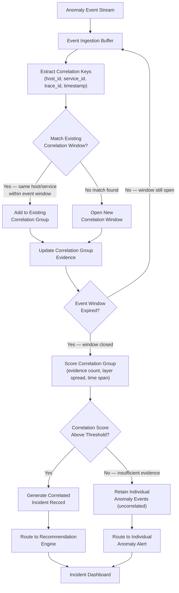

# NEXORA — System Methodology and Intelligent Incident Analysis

> [!IMPORTANT]
> This document describes the **proposed** methodology for the NEXORA AIOps observability platform, designed for the **CICADA 2K26 Hackathon**. All sections are marked **[PROPOSED]** unless explicitly noted otherwise. No production datasets, trained models, or validated metric values exist at this time. Synthetic examples are used throughout for illustration purposes only.

**Related Documents:**
- [ARCHITECTURE.md](ARCHITECTURE.md) — System architecture, component design, and data flows
- [ARCHITECTURE_DECISIONS.md](ARCHITECTURE_DECISIONS.md) — Architecture decision records and design rationale
- [THREAT_MODEL.md](THREAT_MODEL.md) — Security threat model and mitigations

---

## Table of Contents

1. [Methodology Overview](#1-methodology-overview)
2. [Telemetry Sources](#2-telemetry-sources)
3. [Data Preprocessing Methodology](#3-data-preprocessing-methodology)
4. [Privacy-Preserving Telemetry Methodology](#4-privacy-preserving-telemetry-methodology)
5. [Anomaly Detection Methodology](#5-anomaly-detection-methodology)
6. [Cross-Layer Event Correlation](#6-cross-layer-event-correlation)
7. [Explainable Incident Intelligence](#7-explainable-incident-intelligence)
8. [Infrastructure Health Evaluation](#8-infrastructure-health-evaluation)
9. [Autonomous Operations Methodology](#9-autonomous-operations-methodology)
10. [Evaluation and Validation Methodology](#10-evaluation-and-validation-methodology)
11. [Performance and Reliability Targets](#11-performance-and-reliability-targets)
12. [Model Evaluation Metrics](#12-model-evaluation-metrics)
13. [Limitations and Future Improvements](#13-limitations-and-future-improvements)

---

## 1. Methodology Overview

**[PROPOSED]**

NEXORA operates through a five-stage intelligent observability pipeline. Each stage transforms raw environmental signals into actionable intelligence, while preserving strict privacy boundaries at every step. The pipeline is designed to be deterministic and auditable — every inference, alert, and recommendation must be traceable to the specific telemetry that generated it.

```
OBSERVE → DETECT → CORRELATE → RECOMMEND → ACT
```

### Stage 1 — OBSERVE

The OBSERVE stage encompasses all telemetry collection activities within the customer environment. Local Collector agents continuously gather signals from infrastructure, network, application, and security layers. Telemetry is normalized into a canonical event schema and subjected to privacy filtering before any further processing. At this stage, raw data remains entirely within the customer's environment boundary.

**Key activities:**
- Continuous metric polling from infrastructure agents
- Log stream ingestion from application and security sources
- Network performance measurement via passive probes or agent-side instrumentation
- Telemetry normalization into the NEXORA canonical event format
- Privacy filtering and allow-list validation (see [Section 4](#4-privacy-preserving-telemetry-methodology))
- Local buffering to handle transient connectivity outages

### Stage 2 — DETECT

The DETECT stage applies anomaly detection logic to the normalized, privacy-filtered telemetry stream. Detection operates at two levels:

- **Local detection (edge):** Lightweight threshold-based detection runs on the Local Collector to identify obvious breaches before transmission, reducing unnecessary egress.
- **Central detection (SaaS):** More sophisticated statistical and machine-learning-based models run on the centralized platform, operating on the approved metadata stream.

Detection produces **anomaly events** — structured records indicating that a telemetry metric or log pattern has deviated from expected behavior. An anomaly event is not an incident; it is evidence that warrants further investigation.

### Stage 3 — CORRELATE

Individual anomaly events are rarely sufficient to diagnose a problem. The CORRELATE stage groups related anomaly events across telemetry layers, time windows, hosts, and services. Correlation evidence is built from shared identifiers (host ID, service ID, trace ID) and temporal proximity within configurable event windows.

Importantly, correlation identifies **likely relationships** between events — it does not confirm root cause. Correlated event groups are presented to the human operator with the evidence that links them, not as confirmed facts.

### Stage 4 — RECOMMEND

The RECOMMEND stage converts correlated event groups into human-readable incident reports with structured recommendations. Each recommendation includes:

- The specific telemetry evidence that triggered it
- The correlation evidence linking multiple signals
- One or more root-cause hypotheses ranked by evidence strength
- Concrete next-step actions with rationale
- Confidence indicators where quantifiable

Recommendations are always advisory. They are generated from pattern-matching and correlation evidence — not from certainty about root cause.

### Stage 5 — ACT

The ACT stage represents potential automated or human-guided remediation actions. 

> [!WARNING]
> **Autonomous production actions are NOT assumed to be implemented in the NEXORA hackathon prototype.** The ACT stage is documented as a proposed design target. For the prototype, remediation actions may be simulated or presented as human-approved steps only. No automated modification of production infrastructure should occur without explicit operator approval and a validated rollback strategy.

For the prototype scope, ACT means: presenting the operator with a prioritized action plan, capturing their approval decision, and logging the outcome in the audit trail.

---

## 2. Telemetry Sources

**[PROPOSED — Planned Telemetry Schema]**

> [!NOTE]
> No datasets are currently collected or stored. The fields documented below represent the **planned telemetry schema** that NEXORA Local Collectors are designed to gather. Actual data collection will require deployment of Collector agents in a live or simulated environment. Schema definitions may evolve during implementation.

NEXORA monitors four telemetry categories. Each category has a defined set of fields that the Local Collector is intended to capture and normalize into the canonical event format.

### 2.1 Infrastructure Telemetry

Covers host-level resource consumption and system health metrics.

| Field | Type | Unit | Description |
|-------|------|------|-------------|
| `cpu_utilization_pct` | float | % | Percentage of CPU capacity in use, averaged across all cores |
| `memory_utilization_pct` | float | % | Percentage of physical RAM currently allocated |
| `disk_utilization_pct` | float | % | Percentage of disk capacity used per mounted volume |
| `system_uptime_seconds` | integer | seconds | Time elapsed since last system boot |
| `load_average_1m` | float | — | 1-minute load average (Unix-style); number of processes waiting for CPU |
| `load_average_5m` | float | — | 5-minute load average |
| `load_average_15m` | float | — | 15-minute load average |
| `host_id` | string | — | Unique identifier for the host (allow-listed; no PII) |
| `collection_timestamp_utc` | datetime | ISO 8601 | UTC timestamp when the metric was sampled |

### 2.2 Network Telemetry

Covers connectivity, performance, and reliability of network paths.

| Field | Type | Unit | Description |
|-------|------|------|-------------|
| `response_time_ms` | float | ms | End-to-end response time for a sampled service endpoint |
| `latency_ms` | float | ms | Network round-trip latency measured at the collector |
| `packet_loss_pct` | float | % | Percentage of packets lost over a measurement window |
| `network_errors_per_sec` | float | errors/s | Rate of network interface errors (e.g., CRC errors, dropped packets) |
| `interface_id` | string | — | Network interface identifier (allow-listed) |
| `target_service_id` | string | — | Service or endpoint being measured (allow-listed) |
| `collection_timestamp_utc` | datetime | ISO 8601 | UTC timestamp when the measurement was taken |

### 2.3 Application Telemetry

Covers service-level behavior, throughput, and error patterns.

| Field | Type | Unit | Description |
|-------|------|------|-------------|
| `log_level` | enum | — | Severity level of the log entry: DEBUG / INFO / WARN / ERROR / FATAL |
| `log_message_hash` | string | SHA-256 | Hash of the sanitized log message body (raw message is NOT transmitted) |
| `error_rate_per_min` | float | errors/min | Application error events per minute for a given service |
| `request_duration_ms` | float | ms | Measured duration of a single service request |
| `service_failure_count` | integer | count | Number of service failure events within the collection window |
| `service_id` | string | — | Unique identifier for the application service (allow-listed) |
| `trace_id` | string | — | Distributed trace correlation identifier (allow-listed, no user data) |
| `collection_timestamp_utc` | datetime | ISO 8601 | UTC timestamp of the log or metric event |

> [!NOTE]
> Raw log message bodies are **never transmitted**. Only a hash of the sanitized log body is included in egress payloads, allowing the SaaS platform to detect log pattern changes without accessing message content.

### 2.4 Security Telemetry

Covers authentication events and behavioral security signals.

| Field | Type | Unit | Description |
|-------|------|------|-------------|
| `failed_login_attempts_per_min` | float | attempts/min | Rate of failed authentication attempts on a given endpoint |
| `auth_anomaly_flag` | boolean | — | Whether the authentication system flagged this session as anomalous |
| `suspicious_event_frequency` | float | events/min | Rate of events classified as suspicious by the local security agent |
| `auth_endpoint_id` | string | — | Identifier of the authentication endpoint being monitored (allow-listed) |
| `event_category` | enum | — | Category of security event: AUTH_FAILURE / ANOMALY / SUSPICIOUS_PATTERN |
| `collection_timestamp_utc` | datetime | ISO 8601 | UTC timestamp of the security event |

> [!WARNING]
> Security telemetry fields must pass through strict allow-list validation before egress. Any field containing user identity data (usernames, email addresses, IP addresses, session tokens) is **blocked** and must not appear in egress payloads. Only aggregate rates and boolean flags are transmitted.

---

## 3. Data Preprocessing Methodology

**[PROPOSED]**

> [!NOTE]
> Since no datasets currently exist, the following methodology describes the **planned preprocessing pipeline** that will be applied when telemetry data is sourced, simulated, or collected. Actual datasets will need to be obtained or generated before this pipeline can be validated end-to-end.

NEXORA's preprocessing methodology is a ten-step pipeline applied to all telemetry data before it enters any detection or ML model training workflow.

### 3.1 Ten-Step Preprocessing Pipeline

#### Step 1 — Data Ingestion

Telemetry events are ingested from the Local Collector's egress stream (approved metadata payloads) or from synthetic/simulated datasets during development. Each ingestion batch is tagged with a source identifier, schema version, and ingestion timestamp. Ingestion is treated as an append-only operation; existing records are never modified during ingestion.

#### Step 2 — Schema Validation

Every ingested record is validated against the canonical event schema (see [Section 2](#2-telemetry-sources)). Records failing schema validation are:
- Logged to a validation error store with the offending fields identified
- Quarantined and excluded from downstream processing
- Reported in ingestion quality metrics

Schema validation checks include: required field presence, field type correctness, enum value membership, and timestamp format validity.

#### Step 3 — Timestamp Normalization

All event timestamps are normalized to UTC with millisecond precision. Timestamps are parsed from ISO 8601 format and converted to a uniform internal representation. Events with malformed or missing timestamps are flagged; a best-effort timestamp (ingestion time) may be substituted, but the event is marked as `timestamp_inferred: true` to indicate reduced reliability.

> [!NOTE]
> Timestamp integrity is critical for time-series analysis and cross-layer correlation. Events with inferred timestamps must be treated with lower confidence in correlation workflows.

#### Step 4 — Missing-Value Handling

Fields with missing values are handled according to their role:

| Field Role | Handling Strategy |
|------------|------------------|
| Primary key / identifier | Record quarantined; missing identifiers cannot be recovered |
| Required metric | Record flagged; imputation may be applied with explicit annotation |
| Optional metric | Null value preserved; downstream models handle absence explicitly |
| Boolean flag | Missing treated as `false` with annotation; never assumed true |

Imputed values are always annotated with `_imputed: true` on the corresponding field. No silent imputation occurs.

#### Step 5 — Duplicate Detection

Records are deduplicated based on a composite key: `(host_id, service_id, event_category, collection_timestamp_utc)`. Exact duplicates — identical composite keys with identical field values — are dropped and counted in deduplication metrics. Near-duplicate detection (same key, slightly different timestamps within a configurable jitter window) is handled by keeping the earliest record and discarding later arrivals within the window.

#### Step 6 — Data Cleaning

After deduplication, records undergo cleaning:
- Out-of-range metric values are flagged (e.g., `cpu_utilization_pct` > 100 or < 0)
- Negative values for inherently non-negative metrics are flagged as erroneous
- Extreme outlier values (beyond configurable z-score or IQR thresholds) are flagged, not silently removed
- Flagged records are retained but marked for exclusion from model training unless explicitly reviewed

#### Step 7 — Feature Extraction

Domain-specific features are derived from raw fields to improve detection model performance. Examples of [PROPOSED] derived features:

- **Rolling statistics:** Rolling mean, standard deviation, min/max over configurable windows (e.g., 5-min, 15-min, 1-hour)
- **Rate-of-change:** First derivative of metric values to detect rapid increases or decreases
- **Anomaly score precursors:** Z-score of a metric relative to its rolling baseline
- **Log pattern frequency:** Count of unique log message hash occurrences per time window
- **Inter-event intervals:** Time between consecutive security events on the same endpoint

Feature extraction is performed on the training set first; parameters (rolling window sizes, baseline periods) are fixed before application to test data.

#### Step 8 — Normalization and Scaling

Numerical features are normalized to remove scale differences between metrics (e.g., milliseconds vs. percentages). Proposed normalization approaches:

- **Min-max scaling:** Scales values to [0, 1] range; appropriate for bounded metrics like percentages
- **Z-score standardization:** Centers values at mean 0, standard deviation 1; appropriate for unbounded metrics like latency or request duration
- **Log transformation:** Applied to heavily right-skewed distributions (e.g., error counts, event frequencies)

> [!IMPORTANT]
> Scaling parameters (min, max, mean, std dev) are **computed exclusively on the training partition** and applied unchanged to validation and test partitions. Computing these on the full dataset before splitting constitutes data leakage and will produce artificially optimistic model performance estimates.

#### Step 9 — Label Handling

NEXORA's anomaly detection approach is primarily **unsupervised** (see [Section 5](#5-anomaly-detection-methodology)), as labeled anomaly datasets for specific deployment environments are unlikely to be available.

Where labels are available:
- Labels are preserved exactly as provided; they are never inferred or invented by the preprocessing pipeline
- Label imbalance (very few anomaly examples vs. normal) is documented and factored into evaluation methodology
- For supervised evaluation scenarios, labels are attached to events post-split (not used during feature extraction on training data)

> [!WARNING]
> Do not invent or fabricate anomaly labels for unlabeled telemetry. Artificially labeled datasets will produce misleading model evaluation results and cannot substitute for genuine ground-truth annotation.

#### Step 10 — Train/Test Partitioning

Partitioning strategy depends on data type:

**For time-series telemetry data:**
- Partitioning preserves **chronological order** — no random shuffling
- An 80% / 20% split is applied at the temporal boundary: the earliest 80% of the time range forms the training set; the most recent 20% forms the test set
- All feature extraction and scaling parameters are fitted on the training set only
- The test set must represent a time period entirely **after** the training set to simulate real deployment conditions and prevent temporal leakage

**For log data:**
- Log records are partitioned in timestamp order, maintaining event sequence integrity
- If log records carry labels, label distributions are compared across partitions but not adjusted (adjusting would alter the temporal validity of the split)
- Related log records sharing a `trace_id` are kept together within the same partition to avoid splitting correlated event sequences

---

## 4. Privacy-Preserving Telemetry Methodology

**[PROPOSED]**

NEXORA's privacy model is built on a single foundational principle: **raw telemetry never leaves the customer's environment**. Only explicitly approved, structured metadata fields — after passing strict allow-list validation — are transmitted to the centralized SaaS platform. This section describes the full workflow from raw telemetry capture to secure egress.

### 4.1 Privacy Workflow Overview

```
Raw Telemetry → Field Inspection → Allow-List Validation → Sensitive-Field Handling →
Payload Serialization → Egress Verification → Secure Transmission
```

### 4.2 Field Classification

Every field present in a telemetry event is classified into one of five categories before any transmission decision is made:

| Classification | Definition | Egress Action |
|---------------|------------|---------------|
| **Allow-listed** | Field is explicitly defined in the NEXORA allow-list policy with its expected type and format | Included in egress payload as-is |
| **Blocked** | Field is explicitly listed as prohibited (e.g., username, password, IP address, email) | Dropped; never transmitted; flagged in audit log |
| **Redacted** | Field is allow-listed but its value contains a detectable sensitive pattern (e.g., regex match for secret-like strings) | Field key transmitted with `[REDACTED]` as value |
| **Transformed** | Field is allow-listed but requires value transformation before egress (e.g., log body → hash) | Transformed value transmitted; original retained locally |
| **Unknown** | Field is not present in either the allow-list or block-list | **Rejected by default**; event flagged; field dropped from payload |

> [!IMPORTANT]
> **Unknown fields are rejected by default.** The allow-list is a closed set. Any field not explicitly defined in policy is treated as potentially sensitive and excluded from egress. This fail-closed behavior is the primary privacy protection mechanism.

### 4.3 Protection Layers

NEXORA applies two complementary layers of protection:

**Primary layer — Strict Allow-Listing:**
The allow-list policy defines exactly which fields may be transmitted, their expected types, and any value constraints. No field outside this definition can appear in an egress payload. The allow-list is versioned; policy changes require explicit review and are recorded in the audit trail.

**Secondary layer — Regex-Based Sensitive Pattern Detection:**
Even for allow-listed fields, regex-based detectors scan field values for patterns indicative of sensitive data:
- Password-like strings (e.g., matches `password\s*[:=]\s*\S+`)
- API keys and tokens (e.g., matches common token format patterns)
- Personally identifiable information patterns (e.g., email address formats, national ID number patterns)

If a secondary-layer detection fires on an allow-listed field, the field value is **redacted** (replaced with `[REDACTED]`) rather than transmitted. This handles cases where sensitive data unexpectedly appears in a normally safe field (e.g., a password accidentally included in a log message field).

### 4.4 Synthetic Privacy Example

The following illustrates how a raw telemetry event is processed through the privacy workflow. All values are synthetic and for illustration only.

**Raw Event (stays local — never transmitted):**
```json
{
  "host_id": "srv-prod-042",
  "cpu_utilization_pct": 94.7,
  "memory_utilization_pct": 88.3,
  "disk_utilization_pct": 61.2,
  "system_uptime_seconds": 2847600,
  "load_average_1m": 7.82,
  "username": "alice@example.com",
  "auth_token": "eyJhbGciOiJIUzI1NiIsInR5cCI6IkpXVCJ9...",
  "log_message": "Login failed for user alice@example.com with password: S3cr3t!",
  "log_message_raw_hash": "sha256:3f4a9b...",
  "failed_login_attempts_per_min": 14.2,
  "collection_timestamp_utc": "2026-11-20T16:30:00.000Z",
  "internal_debug_flag": true
}
```

**Privacy Processing Decisions:**

| Field | Classification | Disposition |
|-------|---------------|-------------|
| `host_id` | Allow-listed | ✅ Transmitted |
| `cpu_utilization_pct` | Allow-listed | ✅ Transmitted |
| `memory_utilization_pct` | Allow-listed | ✅ Transmitted |
| `disk_utilization_pct` | Allow-listed | ✅ Transmitted |
| `system_uptime_seconds` | Allow-listed | ✅ Transmitted |
| `load_average_1m` | Allow-listed | ✅ Transmitted |
| `username` | Blocked | ❌ Dropped; audit logged |
| `auth_token` | Blocked | ❌ Dropped; audit logged |
| `log_message` | Transformed → then Redacted | ⚠️ Regex detected password pattern; value replaced with `[REDACTED]`; hash transmitted instead |
| `log_message_raw_hash` | Allow-listed (transformed form) | ✅ Transmitted as `log_message_hash` |
| `failed_login_attempts_per_min` | Allow-listed | ✅ Transmitted |
| `collection_timestamp_utc` | Allow-listed | ✅ Transmitted |
| `internal_debug_flag` | Unknown | ❌ Rejected by default; audit logged |

**Approved Egress Payload (transmitted to SaaS):**
```json
{
  "schema_version": "1.0",
  "event_id": "evt-20261120-163000-srv042-infra",
  "policy_version": "nexora-allow-list-v1.2",
  "host_id": "srv-prod-042",
  "cpu_utilization_pct": 94.7,
  "memory_utilization_pct": 88.3,
  "disk_utilization_pct": 61.2,
  "system_uptime_seconds": 2847600,
  "load_average_1m": 7.82,
  "log_message_hash": "sha256:3f4a9b...",
  "failed_login_attempts_per_min": 14.2,
  "collection_timestamp_utc": "2026-11-20T16:30:00.000Z",
  "privacy_processing": {
    "fields_blocked": 2,
    "fields_redacted": 1,
    "fields_rejected": 1,
    "processing_timestamp_utc": "2026-11-20T16:30:00.148Z"
  }
}
```

**Why the raw event must remain local:**

The raw event contains a username (`alice@example.com`), an authentication token, and a log message that includes a plaintext password. Transmitting any of these to an external platform — even one operated by NEXORA — would constitute a privacy and security violation:

1. **Identity exposure:** Usernames and email addresses are personally identifiable information (PII) subject to data protection regulations.
2. **Credential exposure:** Authentication tokens and plaintext passwords, if intercepted or logged on the SaaS side, create a direct security vulnerability.
3. **Regulatory compliance:** Many regulatory frameworks (e.g., GDPR, HIPAA) prohibit transmission of PII to third-party systems without explicit consent and appropriate safeguards.

The raw event is retained locally by the collector for a configurable retention period (proposed: 24–72 hours) for local debugging and audit purposes, then purged according to the customer's data retention policy.

---

## 5. Anomaly Detection Methodology

**[PROPOSED]**

> [!NOTE]
> No anomaly detection models have been implemented or trained. The following describes the proposed detection methodology and candidate model approaches. All models are marked **[PROPOSED]** and will require implementation, training data, and validation before deployment.

NEXORA's anomaly detection methodology distinguishes two fundamentally different detection approaches:

**Static Threshold Detection:**  
Predefined numeric boundaries trigger alerts when metrics breach them (e.g., CPU > 95%). Fast, deterministic, interpretable, but cannot adapt to environment-specific baselines. High false-positive rate in variable environments.

**Behavioral Anomaly Detection:**  
Statistical and ML-based models learn the normal behavior pattern of a metric over time and flag deviations from that learned pattern. Can detect subtle degradation that threshold rules miss. Requires sufficient historical data and tuning; may produce false positives during behavioral regime changes (e.g., after a deployment).

NEXORA proposes using both in combination: threshold rules as a fast first-pass filter, behavioral models for deeper analysis of signals that pass the threshold filter or exhibit gradual degradation without breaching fixed thresholds.

### 5.1 Infrastructure Anomaly Detection

**Target anomaly patterns:**
- Sudden CPU spikes (rapid rise in `cpu_utilization_pct`)
- Sustained memory growth trending toward exhaustion (`memory_utilization_pct` increasing monotonically)
- Abnormal resource utilization relative to historical patterns for the same host and time-of-day
- Sudden performance changes detectable through load average derivatives

### 5.2 Network Anomaly Detection

**Target anomaly patterns:**
- Steadily increasing latency (`latency_ms`) over a monitoring window
- Response-time deviations exceeding historical variance bounds
- Elevated packet loss rates (`packet_loss_pct`) indicating network instability
- Spikes in `network_errors_per_sec` suggesting interface degradation

### 5.3 Application Anomaly Detection

**Target anomaly patterns:**
- Increased error frequency (`error_rate_per_min` rising above rolling baseline)
- Unusual request durations (`request_duration_ms` distribution shift)
- Repeated service failure events (`service_failure_count` accumulating abnormally)
- Log pattern frequency changes (novel log message hash patterns emerging at high frequency)

### 5.4 Security Anomaly Detection

**Target anomaly patterns:**
- Repeated failed login attempts (`failed_login_attempts_per_min` above behavioral baseline)
- Unusual authentication patterns triggering `auth_anomaly_flag`
- Elevated `suspicious_event_frequency` on monitored endpoints

### 5.5 Proposed Detection Model Candidates

#### [PROPOSED] Model A — Statistical Baselines (Rolling Mean + Std Dev)

| Attribute | Detail |
|-----------|--------|
| **Input features** | Any continuous numeric metric (e.g., `cpu_utilization_pct`, `latency_ms`, `error_rate_per_min`) |
| **Detection logic** | Compute rolling mean (μ) and standard deviation (σ) over a training window. Flag observations where `\|value - μ\| > k·σ` (k is a tunable sensitivity parameter, proposed default: k=3) |
| **Output** | Boolean anomaly flag + z-score value indicating deviation magnitude |
| **Advantages** | Simple, highly interpretable, low computational cost, no training required beyond window calculation, works in real time |
| **Limitations** | Assumes approximate normality of metric distribution; sensitive to window size selection; can miss gradual drift if the rolling window moves with the signal; does not capture multi-variate relationships |
| **Computational requirements** | O(w) memory per metric where w is window size; suitable for edge/collector deployment |

#### [PROPOSED] Model B — Isolation Forest

| Attribute | Detail |
|-----------|--------|
| **Input features** | Multi-dimensional feature vectors combining metrics from the same host or service (e.g., [cpu_pct, memory_pct, latency_ms, error_rate]) |
| **Detection logic** | Builds an ensemble of random isolation trees. Anomalies are isolated (reach tree leaves) in fewer splits than normal points, yielding a low anomaly score. Points below a configurable score threshold are flagged |
| **Output** | Anomaly score (continuous) + binary anomaly flag |
| **Advantages** | Effective for high-dimensional feature spaces; unsupervised (no labeled anomaly data required); robust to irrelevant features; handles varying feature distributions well |
| **Limitations** | Scores are relative — calibration to meaningful thresholds requires validation data; can underperform on anomalies that are only unusual in one dimension while normal in others; model retraining needed when normal behavior regime shifts |
| **Computational requirements** | Moderate training cost (O(n·t·log n) where t is number of trees); inference is fast; suitable for central SaaS platform, not recommended for edge collector |

#### [PROPOSED] Model C — One-Class SVM

| Attribute | Detail |
|-----------|--------|
| **Input features** | Scaled feature vectors of normal telemetry observations |
| **Detection logic** | Learns a decision boundary enclosing the region of normal feature space. Observations falling outside this boundary are classified as anomalous |
| **Output** | Binary anomaly flag + signed distance from decision boundary |
| **Advantages** | Robust boundary learning in high-dimensional spaces; effective when normal behavior can be well-characterized; supports non-linear boundaries via kernel functions |
| **Limitations** | Sensitive to kernel and hyperparameter selection (`nu`, `gamma`); does not scale well to very large datasets; requires careful feature normalization; interpretability is limited — the boundary is not easily explainable in metric terms |
| **Computational requirements** | Training cost is O(n²) to O(n³) depending on kernel; inference O(n·sv) where sv is number of support vectors; suited for central SaaS only |

#### [PROPOSED] Model D — Time-Series Forecasting with Residual-Based Detection (ARIMA / Prophet)

| Attribute | Detail |
|-----------|--------|
| **Input features** | Univariate time-series of a single metric (e.g., `cpu_utilization_pct` over time, `latency_ms` over time) |
| **Detection logic** | A forecasting model (ARIMA or Prophet) predicts the expected value of the metric at each future time step. Anomalies are detected when the actual observed value deviates from the forecast by more than a configurable residual threshold (e.g., 3σ of historical residuals) |
| **Output** | Forecast value, actual value, residual, anomaly flag, and direction (above/below forecast) |
| **Advantages** | Naturally captures time-of-day seasonality, weekly patterns, and trend drift; residuals provide an intuitive explanation for the anomaly; forecasting errors can be bounded with confidence intervals |
| **Limitations** | Univariate by default — does not capture cross-metric relationships without extensions; ARIMA requires stationarity assumptions; Prophet requires sufficient historical data for seasonal decomposition; model retraining required as normal patterns shift; higher computational cost than rolling statistics |
| **Computational requirements** | Moderate training cost; suitable for central SaaS platform; not recommended for real-time edge deployment |

---

## 6. Cross-Layer Event Correlation

**[PROPOSED]**

Individual anomaly events, seen in isolation, often appear ambiguous or low-severity. The NEXORA correlation engine connects related anomaly events across telemetry layers to surface the broader pattern of a system problem. Correlation transforms isolated signals into an **incident narrative**.

### 6.1 Correlation Identifiers

The correlation engine uses the following identifiers to link events:

| Identifier | Purpose |
|-----------|---------|
| `host_id` | Links infrastructure, network, application, and security events on the same host |
| `service_id` | Links application and network events associated with the same service |
| `trace_id` | Links distributed request traces across service boundaries |
| `event_window` | Configurable time window (proposed: 5 minutes) within which events are considered temporally related |
| `collection_timestamp_utc` | Establishes event ordering and calculates inter-event delays |

### 6.2 Example Correlation Scenario

The following scenario illustrates how four individually low-severity anomalies can be correlated into a single high-severity incident:

**t₀ + 0s:** Infrastructure anomaly detected — `cpu_utilization_pct` on `srv-prod-042` rises from baseline ~35% to 94.7%. Anomaly event generated.

**t₀ + 45s:** Infrastructure anomaly detected — `memory_utilization_pct` on the same host rises from ~55% to 88.3% as a CPU-intensive process begins allocating memory. Second anomaly event generated, same `host_id`.

**t₀ + 90s:** Network anomaly detected — `latency_ms` from `srv-prod-042` to downstream service increases from baseline ~12ms to 340ms, as the overloaded host slows its network processing. Third anomaly event, same `host_id`.

**t₀ + 150s:** Application anomaly detected — `error_rate_per_min` for the service on `srv-prod-042` rises sharply; timeout errors appear in log pattern analysis. Fourth anomaly event, same `host_id` and `service_id`.

**Correlation result:** All four events share `host_id: srv-prod-042`, fall within a single 5-minute event window, and form a causal-plausible sequence (CPU overload → memory pressure → network degradation → application errors). The correlation engine groups them into a single incident with an infrastructure root-cause hypothesis.

> [!IMPORTANT]
> This is a **correlation**, not a confirmed root cause. The correlation engine identifies that these events are temporally and structurally linked. The human operator must validate whether the CPU spike was indeed the initiating cause and determine the underlying reason (runaway process, misconfigured job, external attack, etc.).

### 6.3 Correlation Process Flowchart



### 6.4 Correlation vs. Root Cause

Correlation evidence establishes that events are related in time and share system identifiers. It does not establish:

- **Causality:** Shared timing does not prove that one event caused another
- **Root cause:** The initiating cause of a correlated group may be an event that NEXORA did not observe (e.g., a code deployment, a configuration change, an external traffic surge)
- **Completeness:** The correlated group may not include all relevant events if some telemetry was unavailable during collection

All incident reports generated from correlated groups must present correlation as **supporting evidence for hypotheses**, not as confirmed facts.

---

## 7. Explainable Incident Intelligence

**[PROPOSED]**

NEXORA converts correlated anomaly groups into structured **Incident Records** — human-readable, evidence-backed summaries that give operators the information they need to understand and act on a system problem.

### 7.1 Incident Record Structure

Every incident record produced by NEXORA contains the following fields:

| Field | Description |
|-------|-------------|
| `incident_id` | Unique identifier for this incident (e.g., `INC-20261120-0042`) |
| `severity` | Assessed severity level: CRITICAL / HIGH / MEDIUM / LOW |
| `affected_component` | Primary affected host, service, or layer (e.g., `srv-prod-042 / payment-service`) |
| `detection_timestamp_utc` | When the first anomaly in the correlated group was detected |
| `incident_opened_timestamp_utc` | When the correlation engine closed the event window and created the incident |
| `supporting_telemetry` | List of specific metric readings that triggered anomaly events (with timestamps and values) |
| `related_events` | List of anomaly event IDs grouped into this incident |
| `correlation_evidence` | Description of the identifiers and temporal relationships linking the events |
| `root_cause_hypotheses` | Ordered list of plausible root-cause explanations with supporting evidence for each |
| `recommended_next_steps` | Prioritized list of actions with explicit rationale |
| `confidence_indicator` | Qualitative strength of evidence: STRONG / MODERATE / WEAK / INSUFFICIENT |
| `evidence_count` | Number of distinct anomaly events contributing to this incident |
| `operator_status` | Current operator response state: OPEN / ACKNOWLEDGED / IN_PROGRESS / RESOLVED |

### 7.2 Explainability Requirements

**Recommendations must explain WHY they were generated.** A recommendation that says "Restart the service" without context is not acceptable. Each recommended action must include:

- The specific telemetry that makes this action relevant (e.g., "Service failure count has reached 23 in the last 10 minutes, suggesting the service is in a failure loop")
- The hypothesis it is intended to test or address (e.g., "If the root cause is a memory leak in this process, a restart will temporarily restore availability")
- The expected outcome if the action is effective (e.g., "Memory utilization should decrease and error rate should return to baseline within 2–3 minutes of restart")
- The limitation of this action (e.g., "A restart does not address the underlying memory leak; further investigation of the application code or recent deployments is required")

### 7.3 Speculative vs. Confirmed Information

NEXORA incident records must clearly distinguish:

| Information Type | Presentation Standard |
|-----------------|----------------------|
| **Observed fact** | Stated directly: "CPU utilization reached 94.7% at 16:30:00 UTC" |
| **Detected anomaly** | Stated as detection: "NEXORA detected an anomaly in CPU utilization exceeding the statistical threshold" |
| **Correlation** | Stated as evidence linkage: "This event is correlated with 3 other anomalies on the same host within the same 5-minute window" |
| **Root-cause hypothesis** | Explicitly labelled: "HYPOTHESIS: The CPU spike may be related to the elevated failed-login rate on the same host, possibly indicating a brute-force attack consuming authentication resources" |
| **Recommendation** | Stated as advisory: "RECOMMENDED ACTION: Investigate running processes on srv-prod-042 to identify the CPU-consuming process. This recommendation is based on sustained CPU utilization above 90% for more than 5 minutes." |

Speculative root-cause hypotheses must never be presented as confirmed facts, regardless of evidence strength.

---

## 8. Infrastructure Health Evaluation

**[PROPOSED]**

NEXORA maintains a continuous **Health Score** for each monitored host and service. The health score aggregates telemetry signals into a single human-readable state, enabling at-a-glance status visibility on the dashboard.

### 8.1 Health States

| State | Indicator | Meaning |
|-------|-----------|---------|
| **Excellent** | 🟢 Green | All monitored metrics within normal bounds; no active anomalies |
| **Good** | 🟡 Yellow | Minor deviations detected; no active anomalies; watch warranted |
| **Fair** | 🟠 Orange | One or more anomalies detected; performance degradation possible; investigation recommended |
| **Poor** | 🔴 Red | Multiple anomalies active; significant degradation likely; immediate attention required |

### 8.2 Proposed Scoring Methodology

Health scoring is computed from five signal categories. Each category contributes a weighted sub-score. The proposed weighting below is **indicative only** — actual weights require calibration against operational data.

| Signal Category | Contributing Metrics | Proposed Weight |
|----------------|---------------------|-----------------|
| CPU health | `cpu_utilization_pct`, `load_average_1m` | 25% |
| Memory health | `memory_utilization_pct` | 20% |
| Network health | `latency_ms`, `packet_loss_pct`, `network_errors_per_sec` | 20% |
| Application health | `error_rate_per_min`, `service_failure_count`, `request_duration_ms` | 25% |
| Security health | `failed_login_attempts_per_min`, `auth_anomaly_flag`, `suspicious_event_frequency` | 10% |

> [!WARNING]
> **[PROPOSED — requires calibration]** The specific threshold values used to map metric readings to sub-scores have not been validated against real operational data. The thresholds below are illustrative starting points only and must be calibrated for each deployment environment before being used in production health reporting.

### 8.3 Illustrative Threshold Mapping (Requires Calibration)

| Metric | Excellent | Good | Fair | Poor |
|--------|-----------|------|------|------|
| `cpu_utilization_pct` | < [TBD]% | [TBD]–[TBD]% | [TBD]–[TBD]% | > [TBD]% |
| `memory_utilization_pct` | < [TBD]% | [TBD]–[TBD]% | [TBD]–[TBD]% | > [TBD]% |
| `latency_ms` | < [TBD] ms | [TBD]–[TBD] ms | [TBD]–[TBD] ms | > [TBD] ms |
| `error_rate_per_min` | < [TBD] | [TBD]–[TBD] | [TBD]–[TBD] | > [TBD] |
| `failed_login_attempts_per_min` | < [TBD] | [TBD]–[TBD] | [TBD]–[TBD] | > [TBD] |

> [!NOTE]
> Thresholds marked [TBD] must be determined through empirical analysis of baseline telemetry from each deployment environment. Generic industry thresholds may serve as a starting point but should not be treated as universally valid. Environments with different workload patterns, peak hours, and resource configurations will require different calibration.

### 8.4 Active Anomaly Override

Regardless of the computed metric-based score, the health state is subject to the following override rules:

- **Any CRITICAL anomaly active** → State is immediately set to **Poor**, regardless of raw metric scores
- **Any HIGH anomaly active** → State cannot exceed **Fair**
- **Any MEDIUM anomaly active** → State cannot exceed **Good**

These overrides ensure that the health state reflects the current incident situation even when underlying metric values have not yet breached their individual thresholds.

---

## 9. Autonomous Operations Methodology

**[PROPOSED]**

NEXORA's Autonomous Operations methodology extends the five-stage pipeline into a structured framework for progressing from detection to remediation. The framework is designed with **human-in-the-loop** control at the action stage.

### 9.1 Five-Stage Operations Framework

| Stage | Function | Prototype Status |
|-------|----------|-----------------|
| **Observe** | Continuous telemetry collection and normalization | Proposed implementation |
| **Detect** | Threshold and behavioral anomaly detection | Proposed implementation |
| **Correlate** | Cross-layer event grouping and incident formation | Proposed implementation |
| **Recommend** | Explainable incident intelligence and action proposals | Proposed implementation |
| **Act** | Execution of approved remediation actions | **Prototype: human approval and simulation only** |

### 9.2 ACT Stage — Human Approval Workflow

The ACT stage is the most sensitive part of the operations framework. For the NEXORA prototype, the following process governs all actions:

```
Recommendation Generated → Human Review → Approval Decision → Action Validation →
Execution (or Simulation) → Status Recording → Audit Trail → Rollback Strategy
```

**Human Approval Required:**
No action may proceed without explicit operator approval. The operator is presented with:
- The recommended action and its rationale
- The expected outcome
- The risk assessment (potential impact of the action)
- An explicit approve / reject / defer choice

**Action Validation:**
Before execution, the action is validated against:
- A pre-defined allowed-action list (actions not on this list cannot be executed)
- Current system state (is the action still appropriate given current telemetry?)
- Dependency checks (are downstream services that would be affected currently healthy?)

**Execution Status:**
The action engine records: start time, completion time, outcome (success / failure / partial), and any error messages from the execution environment.

**Audit Trail:**
Every action approval, execution, and outcome is immutably recorded in the NEXORA audit log, including:
- Operator identity (or system identity for automated actions, if permitted in future versions)
- Approval timestamp
- Action parameters
- Execution result
- Post-action telemetry snapshot

**Rollback Strategy:**
For every proposed action, a rollback procedure must be defined before the action is approved. If no rollback is possible (irreversible action), this must be explicitly acknowledged by the operator before proceeding.

### 9.3 Prototype Scope: Implemented vs. Proposed

| ACT Capability | Prototype Scope |
|---------------|----------------|
| Present recommended actions to operator | Proposed implementation |
| Record operator approval/rejection | Proposed implementation |
| Execute simulated actions (no real system change) | Proposed implementation |
| Execute real remediation actions (e.g., restart service) | **[PROPOSED — not in prototype; requires production validation]** |
| Automated action without human approval | **[NOT in scope — requires extensive safety validation]** |
| Rollback execution | Proposed — requires environment-specific implementation |

> [!CAUTION]
> Autonomous execution of remediation actions in production environments without human approval is a high-risk capability that requires extensive safety engineering, failure-mode analysis, and regulatory review before deployment. NEXORA's prototype deliberately excludes this capability to avoid unintended production impact during development and demonstration.

---

## 10. Evaluation and Validation Methodology

**[PROPOSED]**

The following test scenarios define the validation criteria for the NEXORA prototype. Each scenario specifies a controlled input, the expected system behavior, the evidence to collect to verify correct behavior, and the pass/fail criteria.

> [!NOTE]
> These scenarios are designed to be executed in a controlled test environment using synthetic telemetry inputs. No real production systems should be used for initial validation testing.

| # | Scenario | Input | Expected Behavior | Evidence to Collect | Pass/Fail Criteria |
|---|----------|-------|-------------------|--------------------|--------------------|
| 1 | Raw log containing password/secret | Log event with field: `log_message: "password: S3cr3t!"` | Privacy filter detects sensitive pattern; field redacted or blocked; event not transmitted with raw value | Privacy audit log entry; egress payload showing `[REDACTED]` or field absence | **PASS:** Sensitive value absent from egress payload. **FAIL:** Plaintext password present in transmitted payload |
| 2 | Unknown field in telemetry event | Event containing field: `internal_debug_flag: true` (not in allow-list) | Allow-list rejects unknown field; field dropped from egress payload; event logged in audit | Audit log entry for rejected field; egress payload without `internal_debug_flag` | **PASS:** Unknown field absent from transmitted payload. **FAIL:** Unknown field present in egress |
| 3 | Collector goes offline | Simulate network disconnection from collector to SaaS for 10 minutes | Collector buffers all events locally; on reconnect, buffered events transmitted in order; no data loss | Buffer queue depth during outage; successful delivery count after reconnect; gap analysis of event timestamps | **PASS:** All buffered events delivered; no timestamp gaps; zero duplicates. **FAIL:** Events lost or duplicated |
| 4 | Repeated failed logins | Inject `failed_login_attempts_per_min: 45` for 3 consecutive collection intervals | Security anomaly detection triggers; anomaly event generated; alert surfaced on dashboard | Anomaly event record; alert timestamp; detection latency from first anomalous reading | **PASS:** Anomaly detected within [target latency]; alert visible. **FAIL:** No anomaly detected despite sustained elevated rate |
| 5 | CPU and memory spikes | Inject `cpu_utilization_pct: 96.0` and `memory_utilization_pct: 91.5` on same host | Infrastructure anomaly events generated for both metrics; correlation engine links them (same host, same window) | Anomaly event records for both metrics; correlation group record showing both events linked | **PASS:** Both anomalies detected; correlated into single incident. **FAIL:** Anomalies not detected or not correlated |
| 6 | Increasing network latency | Inject `latency_ms` gradually rising from 15ms to 280ms over 10 collection intervals | Network anomaly detection triggers before latency reaches maximum; alert generated | Anomaly event timestamp vs. latency progression; detection point in the latency sequence | **PASS:** Anomaly detected before final peak. **FAIL:** Detection occurs only at maximum or not at all |
| 7 | Related infrastructure and application anomalies | Inject CPU spike on `srv-prod-042` and elevated `error_rate_per_min` for `payment-service` on same host | Correlation engine links infrastructure and application anomalies; correlated incident created with cross-layer evidence | Incident record showing both anomaly event IDs; correlation evidence citing shared `host_id` and `service_id` | **PASS:** Cross-layer correlation present in incident record. **FAIL:** Anomalies appear as separate unlinked events |
| 8 | Duplicate events | Inject identical event records with the same composite key twice within the same ingestion batch | Deduplication logic retains one copy; second copy discarded; deduplication count metric incremented | Ingestion record count before and after deduplication; deduplication audit log | **PASS:** Exactly one copy retained; deduplication metric incremented. **FAIL:** Duplicate record persists in processed dataset |
| 9 | Out-of-order timestamps | Inject events where `collection_timestamp_utc` values arrive out of chronological order | Timestamp normalization reorders events by UTC timestamp; downstream processing uses correct order | Event order in processed stream vs. ingestion order; timestamp normalization log | **PASS:** Events processed in timestamp order. **FAIL:** Events processed in arrival order, corrupting time-series analysis |
| 10 | Network reconnection after outage with buffered delivery | Collector buffers 50 events during 10-minute outage; reconnects; delivers buffered batch | All 50 buffered events delivered exactly once; no events lost; no duplicates; timestamps preserved | Delivered event count; timestamp range coverage; duplicate check on composite keys | **PASS:** 50 events delivered, zero lost, zero duplicated, timestamps intact. **FAIL:** Any event lost or duplicated |
| 11 | Egress payload mismatch | Inject scenario where SaaS-received payload hash does not match approved payload hash | Egress proof verification detects mismatch; event flagged as potentially tampered; alert generated; event not processed | Egress proof verification log; mismatch alert record; event status (flagged, not processed) | **PASS:** Mismatch detected and flagged; event excluded from processing. **FAIL:** Mismatched event processed as valid |
| 12 | Remediation approval and audit trail | Trigger incident recommendation; simulate operator approval of recommended action | Action approval captured with operator identity and timestamp; action execution recorded; audit log entry created with full context | Audit log entry containing: incident ID, recommended action, operator approval timestamp, execution result, post-action snapshot | **PASS:** Complete audit trail present and queryable. **FAIL:** Any element of audit trail absent or incomplete |

---

## 11. Performance and Reliability Targets

**[PROPOSED ENGINEERING TARGETS — not measured]**

> [!WARNING]
> The targets listed below are **proposed engineering targets** established at design time. They have not been measured, validated, or benchmarked against any implementation. They represent design aspirations for the NEXORA prototype and production system. Actual performance must be measured against these targets during and after implementation.

### 11.1 Latency Targets

#### Collection-to-Dashboard Latency ≤ 10 seconds (P95)

**Definition:** Time elapsed from when a telemetry event is captured by the Local Collector to when the processed result (anomaly alert or metric update) is visible on the NEXORA dashboard.

**How to measure:** Inject a synthetic telemetry event with a known timestamp at the collector. Record the timestamp when the corresponding dashboard update appears. Measure the difference. Repeat across 100+ injections; report P95 of the distribution.

**Contributes to:** Operator situational awareness and time-to-detect.

#### Threshold Breach to Alert ≤ 15 seconds

**Definition:** Time elapsed from when a metric value crosses an anomaly threshold to when the resulting alert is surfaced on the dashboard and/or notification system.

**How to measure:** Inject a synthetic metric reading that breaches the configured threshold. Record the threshold-crossing timestamp and the alert creation timestamp. Measure the difference. Repeat and report P95.

#### Collector Offline Detection ≤ 60 seconds

**Definition:** Maximum time from when a Local Collector stops sending heartbeats to when the NEXORA SaaS platform marks the collector as offline and generates a connectivity alert.

**How to measure:** Terminate the collector process or disconnect its network. Record the last heartbeat timestamp and the collector-offline alert timestamp. Measure the difference. Repeat across multiple collector shutdown scenarios.

#### After Recoverable Outage — Zero Lost Records, Zero Duplicates

**Definition:** Following a recoverable collector connectivity outage (network interruption with subsequent reconnection), the full set of events captured during the outage period must be delivered exactly once — no events lost and no events duplicated.

**How to measure:** Execute Validation Scenario #10 (see [Section 10](#10-evaluation-and-validation-methodology)) with varying outage durations and buffer sizes. Verify delivered event count equals expected count; verify zero duplicate composite keys; verify timestamp range is contiguous.

---

## 12. Model Evaluation Metrics

**[PROPOSED]**

> [!NOTE]
> No models have been trained and no metric values exist. The metrics defined below establish the **evaluation framework** to be applied when model development proceeds. Do not fabricate or estimate metric values.

Where machine learning models are used for anomaly detection, the following evaluation metrics apply:

### 12.1 Classification Metrics

| Metric | Definition | Relevance to Anomaly Detection |
|--------|-----------|-------------------------------|
| **Precision** | True Positives / (True Positives + False Positives) | Proportion of raised alerts that are genuine anomalies; low precision → alert fatigue |
| **Recall** | True Positives / (True Positives + False Negatives) | Proportion of genuine anomalies that were detected; low recall → missed incidents |
| **F1-Score** | Harmonic mean of Precision and Recall | Balanced measure when both false positives and false negatives are costly |
| **Confusion Matrix** | TP / FP / TN / FN counts | Full picture of classification performance across all outcome types |
| **False-Positive Rate (FPR)** | False Positives / (False Positives + True Negatives) | Rate at which normal events are incorrectly flagged as anomalous |
| **Detection Latency** | Time from anomaly onset to detection event | How quickly the model identifies a problem after it begins |

### 12.2 Time-Series Evaluation Requirements

Standard random-split evaluation is **not valid** for time-series anomaly detection. The following requirements apply:

- **Event-level evaluation:** Each individual time-step or event is evaluated separately; aggregating across time windows must be done carefully to avoid double-counting
- **Chronological testing:** Test data must always represent time periods after the training period — no random shuffling across time (see [Section 3.1, Step 10](#step-10--traintest-partitioning))
- **Anomaly onset evaluation:** Detection latency is measured from the first time step of the anomaly period, not from when the anomaly becomes severe
- **Rolling-window evaluation:** Where behavioral models use rolling baselines, evaluation must account for the warm-up period during which the model's baseline is not yet stable

### 12.3 Evaluation Constraints

- Metric values must be computed from actual model outputs on a held-out test set
- Evaluation must be repeated across multiple test windows to assess consistency
- Precision-Recall tradeoff curves (not just single operating-point values) should be reported where threshold tuning is involved
- Model comparison between candidate approaches (Section 5.5) must use identical dataset splits and evaluation procedures

---

## 13. Limitations and Future Improvements

**[PROPOSED]**

This section documents known limitations of the NEXORA design as proposed for the CICADA 2K26 hackathon prototype, and practical improvements for future development stages.

### 13.1 Current Limitations

#### Incomplete Telemetry Coverage
The proposed telemetry schema covers four categories (infrastructure, network, application, security), but many real-world environments expose additional telemetry sources — container orchestration events, cloud provider metrics, database query performance, CDN edge metrics — that are not currently addressed. Gaps in telemetry coverage create corresponding blind spots in anomaly detection.

#### Dataset Differences Across Environments
NEXORA's anomaly detection models, once trained, will reflect the behavioral patterns of the specific environment used for training. Deploying a model trained on one environment's telemetry to a different environment (different infrastructure scale, workload patterns, peak hours) may produce incorrect baselines and poor anomaly detection performance. Per-environment model retraining or fine-tuning is likely required.

#### False Positives and Alert Fatigue
Statistical and behavioral anomaly detection models produce false positives, particularly during behavioral regime changes (deployments, maintenance windows, seasonal workload shifts). Without continuous recalibration, the false-positive rate may increase over time, leading to alert fatigue and reduced operator trust in the system.

#### Limited Training Labels
Anomaly detection in operational environments is primarily an unsupervised problem because labeled datasets (events where anomalies are definitively confirmed) are rarely available. Without labels, model performance evaluation on real data is limited to qualitative assessment, making it difficult to quantify improvement.

#### Resource Constraints on Collectors
Local Collector agents run within the customer's environment. Resource-constrained environments (edge devices, embedded systems, legacy on-premises servers) may not support the computational requirements of more sophisticated detection models. The collector must remain lightweight enough to avoid adding to the resource pressure it is designed to monitor.

#### Cross-Environment Schema Differences
Different cloud providers, operating systems, and application frameworks expose metrics using different field names, units, and collection intervals. NEXORA's normalization layer must handle this heterogeneity, but schema differences in environments not tested during development may require additional adapter work before the collector can function correctly.

#### Need for Further Validation Before Autonomous Production Actions
The autonomous operations pipeline (see [Section 9](#9-autonomous-operations-methodology)) is intentionally constrained to human-approved actions in the prototype. Autonomous production actions require extensive safety validation, failure-mode analysis, rollback testing, and regulatory review before they can be safely deployed. This validation is out of scope for the prototype.

### 13.2 Future Improvements

| Improvement Area | Description |
|----------------|-------------|
| **Extended telemetry adapters** | Develop adapters for container orchestration (Kubernetes events), cloud-native metrics (AWS CloudWatch, GCP Monitoring), and database performance telemetry |
| **Federated model training** | Explore federated learning approaches that allow model improvement across customer environments without centralizing raw telemetry |
| **Adaptive threshold calibration** | Implement automated baseline recalibration on a rolling schedule to reduce false-positive rates as workload patterns evolve |
| **Supervised fine-tuning pipeline** | Build a workflow for customers to annotate confirmed incidents, enabling supervised fine-tuning of detection models with real ground-truth labels |
| **Multi-environment model portability** | Research transfer learning or domain-adaptation techniques to reduce the need for full per-environment retraining |
| **Richer correlation evidence** | Extend the correlation engine to incorporate deployment event logs, change management records, and external event feeds (e.g., cloud provider status pages) as correlation signals |
| **Automated rollback execution** | With sufficient safety validation, implement automated rollback capability for reversible remediation actions (e.g., configuration rollback, traffic rerouting) with strict pre-conditions and guardrails |
| **Formal validation of performance targets** | Instrument the NEXORA platform to continuously measure collection-to-dashboard latency, alert generation latency, and collector offline detection time against the targets in [Section 11](#11-performance-and-reliability-targets) |
| **Operator feedback loop** | Capture operator accept/reject decisions on recommended actions and anomaly alerts; use this signal to improve recommendation ranking and reduce false-positive rates over time |

---

*Document generated for the NEXORA AIOps Platform — CICADA 2K26 Hackathon Submission*  
*All content is [PROPOSED] unless explicitly stated otherwise.*  
*See [ARCHITECTURE.md](ARCHITECTURE.md) for system architecture details.*  
*See [THREAT_MODEL.md](THREAT_MODEL.md) for security analysis.*  
*See [ARCHITECTURE_DECISIONS.md](ARCHITECTURE_DECISIONS.md) for design decision rationale.*
