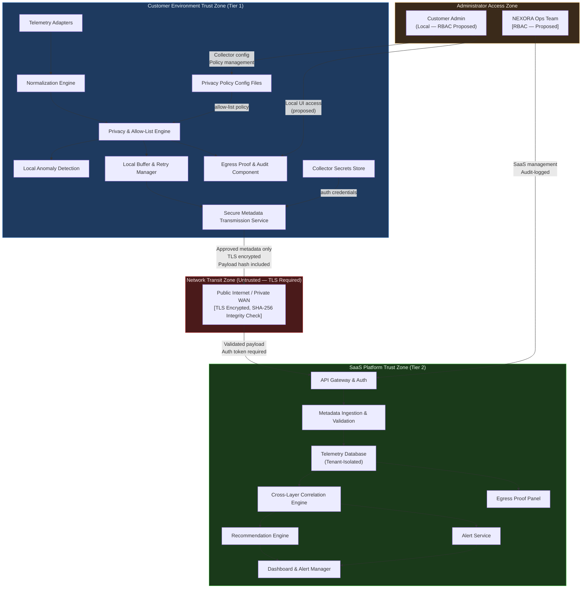

# NEXORA — Security Threat Model

> **Document Status:** Design-Phase Threat Model — NEXORA is a proposed system built for the CICADA 2K26 hackathon. No formal security audit, penetration test, or independent security certification has been conducted. All mitigations described in this document are **[PROPOSED]** design-level controls, not validated or implemented security measures.

**Related Documents:**
- [ARCHITECTURE.md](ARCHITECTURE.md)
- [METHODOLOGY.md](METHODOLOGY.md)
- [ARCHITECTURE_DECISIONS.md](ARCHITECTURE_DECISIONS.md)

---

## Table of Contents

1. [Introduction](#1-introduction)
2. [Assets to Protect](#2-assets-to-protect)
3. [Trust Boundaries](#3-trust-boundaries)
4. [Threat Actors](#4-threat-actors)
5. [Attack Surface](#5-attack-surface)
6. [Threat Table](#6-threat-table)
7. [Residual Risks](#7-residual-risks)
8. [Security Design Principles](#8-security-design-principles)
9. [Future Security Enhancements](#9-future-security-enhancements)

---

## 1. Introduction

### 1.1 Purpose

This document is the **design-phase threat model** for NEXORA, a proposed AIOps observability platform developed for the CICADA 2K26 hackathon. Its purpose is to:

- Enumerate the assets the system must protect
- Map trust boundaries between system components
- Identify plausible threat actors and their capabilities
- Analyze the attack surface exposed by the proposed architecture
- Document known threats with proposed mitigations
- Explicitly record residual risks that cannot be fully mitigated by design alone

This threat model is authored by the engineering team as a **design-time security exercise**. It does not replace a formal security audit, penetration test, or independent security review.

> [!IMPORTANT]
> No penetration testing, vulnerability scanning, or formal security certification has been performed against NEXORA. This document represents the team's best design-phase reasoning about security risks — not a validated security posture.

### 1.2 Scope

NEXORA's proposed architecture spans two deployment tiers:

| Tier | Location | Scope |
|------|----------|-------|
| **Tier 1 — Local Collector** | Customer's own environment (on-premises, private cloud, or public cloud) | Telemetry collection, normalization, privacy filtering, local anomaly detection, local buffering, egress proof generation, and secure transmission |
| **Tier 2 — Centralized SaaS Platform** | NEXORA-operated cloud infrastructure | Metadata ingestion, validation, storage, cross-layer correlation, anomaly analysis, explainable recommendations, alert management, and dashboard (including Egress Proof Panel) |

The threat model covers both tiers, their interconnection, and the trust boundary between them.

**Out of Scope:**
- Specific cloud provider infrastructure security (assumed handled by provider)
- End-user device security (browser-side dashboard access)
- Physical security of customer data centers

### 1.3 Methodology

This threat model follows a structured design-phase methodology:

```
Asset Identification
       ↓
Trust Boundary Mapping
       ↓
Threat Actor Enumeration
       ↓
Attack Surface Analysis
       ↓
Threat / Mitigation Table (per-threat, per-component)
       ↓
Residual Risk Documentation
```

Each threat is assigned a unique identifier (`T-NNN`), mapped to affected components, assessed for potential impact, and paired with proposed mitigations. Validation methods reference NEXORA's proposed test case framework where applicable.

---

## 2. Assets to Protect

The following table enumerates the primary assets NEXORA must protect, their sensitivity, and their location in the architecture.

| Asset | Sensitivity | Location | Description |
|-------|-------------|----------|-------------|
| **Local Raw Telemetry** | 🔴 Highest | Tier 1 — Collector host | Infrastructure metrics, application logs, network flows, security events in their raw, unfiltered form. May contain PII, credentials, internal IP topology, process names, and sensitive configuration values. This data **must never leave the customer environment**. |
| **Egress Proof Records / Audit Trail** | 🟠 High | Tier 1 — Egress Proof & Audit Component | The append-only record of what was collected, what was approved by the allow-list policy, what was filtered, and the SHA-256 hash of each transmitted payload. Used for compliance and auditability. |
| **Privacy Policy Configuration** | 🟠 High | Tier 1 — Allow-List Policy Engine | The allow-list configuration defining which metadata fields are approved for egress. Unauthorized modification can silently expand what is transmitted to SaaS. |
| **Collector Configuration and Secrets** | 🟠 High | Tier 1 — Collector host | API keys, collector identity credentials, authentication tokens, and configuration files. Compromise enables impersonation and unauthorized data injection. |
| **Approved Metadata in Transit** | 🟡 Medium–High | Network Transit Zone | The filtered metadata payload traversing the network boundary from Tier 1 to Tier 2. Sensitive only in aggregate; payload is already privacy-filtered but represents real infrastructure signals. |
| **SaaS-Stored Metadata and Tenant Data** | 🟠 High | Tier 2 — Telemetry DB, Correlation Engine | Aggregated, correlated metadata for all tenants. Cross-tenant exposure is a critical risk. |
| **SaaS API Authentication Tokens** | 🔴 Highest (for SaaS access) | Tier 2 — API Gateway; Tier 1 — Collector config | Long-lived tokens allow unauthorized data injection, impersonation, or cross-tenant access if compromised. |
| **Recommendation Engine Outputs** | 🟡 Medium | Tier 2 — Recommendation Engine | Actionable remediation steps. If tampered with, could trigger unintended production changes. |
| **Egress Proof Panel Data** | 🟡 Medium | Tier 2 — Dashboard | The SaaS-side view of egress proof records. Used to verify integrity of transmitted payloads. Tampering invalidates the audit trail's value. |

---

## 3. Trust Boundaries

### 3.1 Trust Boundary Diagram



### 3.2 Trust Boundary Descriptions

| Boundary | Zone A | Zone B | Data Crossing | Protection Required |
|----------|--------|--------|---------------|---------------------|
| **TB-1** | Customer Environment (Tier 1) | Network Transit Zone | Approved metadata payload + egress proof hash | TLS encryption, payload integrity hash, authentication token |
| **TB-2** | Network Transit Zone | SaaS Platform (Tier 2) | Same payload received by API Gateway | Token validation, schema validation, tenant scoping |
| **TB-3** | Customer Environment | Administrator Access Zone | Privacy policy config, collector config | OS-level access controls, audit logging |
| **TB-4** | SaaS Platform | Administrator Access Zone | Management operations, configuration changes | RBAC [proposed], audit logging, MFA [proposed] |

> [!WARNING]
> The most critical trust boundary is **TB-1**: the egress from the Customer Environment. Once data crosses this boundary, the customer's raw telemetry privacy protections no longer apply. The design enforces that only allow-listed metadata crosses TB-1 — but this guarantee depends entirely on the integrity of the collector software and its host.

---

## 4. Threat Actors

| Actor | Motivation | Capability | Access Point |
|-------|-----------|-----------|-------------|
| **External Attacker — SaaS API** | Data theft, service disruption, unauthorized access to tenant data | Moderate–High; skilled attacker with network access and knowledge of web API patterns | SaaS API ingestion endpoint, authentication layer, dashboard |
| **Malicious Insider — Customer Organization** | Data exfiltration, sabotage, unauthorized access to raw telemetry | High; has legitimate access to the customer environment and may have shell access to collector host | Collector host OS, privacy policy config files, local buffer, egress proof records |
| **Compromised Collector Host** | (System, not a person) — lateral movement vector, persistent access | High; attacker operating with collector process privileges or OS-level access | All Tier 1 components simultaneously |
| **Rogue SaaS Tenant** | Access another tenant's data; competitive intelligence; disruption | Low–Moderate; uses only legitimate SaaS API credentials but probes for multi-tenancy isolation failures | SaaS API, tenant-scoped query endpoints, dashboard |
| **Supply Chain Attacker** | Embed persistent backdoor in collector software; exfiltrate telemetry; bypass privacy controls | High; compromises upstream build/distribution pipeline | Collector software package, installer, update mechanism |
| **Automated Scanner / Opportunistic Bot** | Credential stuffing, vulnerability probing, denial of service | Low–Moderate; automated tools with broad coverage | SaaS API public endpoints, authentication endpoints, any exposed network interface |

---

## 5. Attack Surface

The following attack surfaces are identified in the NEXORA proposed architecture:

| ID | Attack Surface | Location | Exposure Type |
|----|---------------|----------|---------------|
| **AS-01** | Collector-to-SaaS transmission channel | Network Transit Zone (TB-1 / TB-2) | Network-level interception, MitM, replay |
| **AS-02** | Collector host (OS, process, config files) | Tier 1 — Customer Environment | Local privilege escalation, process injection, config file manipulation |
| **AS-03** | SaaS API ingestion endpoint | Tier 2 — API Gateway | Unauthorized injection, brute force, replay, schema abuse |
| **AS-04** | Privacy policy configuration files | Tier 1 — Allow-List Policy Engine | File system manipulation, unauthorized policy expansion |
| **AS-05** | Local buffer storage | Tier 1 — Local Buffer & Retry Manager | Direct file write, buffer poisoning before transmission |
| **AS-06** | Egress proof records | Tier 1 — Egress Proof & Audit Component | Record tampering, deletion, forgery |
| **AS-07** | Dashboard and alert management interface | Tier 2 — Dashboard | Unauthorized access, session hijacking, data exfiltration via UI |
| **AS-08** | Recommendation engine outputs | Tier 2 — Recommendation Engine | Output manipulation leading to harmful remediation actions |
| **AS-09** | Collector authentication credentials | Tier 1 — Collector config / secrets store | Credential theft, unauthorized use of stolen tokens |

---

## 6. Threat Table

> [!IMPORTANT]
> All mitigations in this table are **[PROPOSED]** design-level controls. No implementation or validation has occurred. The "Validation Method" column references planned test cases, not completed tests.

| Threat ID | Threat Description | Affected Component | Potential Impact | Proposed Mitigation | Validation Method | Status |
|-----------|-------------------|-------------------|-----------------|--------------------|--------------------|--------|
| **T-001** | Sensitive information leakage via outgoing payload — a field not on the allow-list passes through the Privacy Filtering Engine and is transmitted to SaaS | Privacy Filtering Engine / Allow-List Policy Engine | PII, credentials, or internal network topology exposed to the SaaS platform; privacy guarantee violated | Strict fail-closed allow-list (unknown fields blocked by default, not passed through); egress payload audit log captures field-level decisions; unknown field triggers block event | TC-001: inject raw log containing password field; verify field absent in egress payload. TC-002: inject unknown field not on allow-list; verify blocked and logged | [Proposed] |
| **T-002** | Malicious telemetry injection — an attacker with write access to monitored data sources injects crafted telemetry to manipulate anomaly signals | Telemetry Collection Engine | False anomaly signals, alert flooding, manipulated infrastructure health scores, suppression of legitimate alerts | Input validation at collection; schema enforcement on normalized telemetry; source authentication where data source supports it; anomaly scoring windowing to reduce single-event impact | TC-010: inject anomalous telemetry payload; verify input validation rejects malformed events | [Proposed] |
| **T-003** | Unauthorized local collector access — an attacker gains shell or process-level access to the collector host | Local Collector — all subcomponents | Local raw telemetry exposed; privacy policy modified to expand egress; egress proof records tampered; full Tier 1 trust-boundary breach | OS-level process isolation; collector runs under dedicated least-privilege account; secrets stored in OS secret store (not plaintext config files); file system permissions restrict access to collector-owned directories | Host security posture review; OS-level access control audit | [Proposed] |
| **T-004** | API authentication abuse — stolen, brute-forced, or leaked collector API credentials are used to inject unauthorized data or impersonate a legitimate collector | Metadata Ingestion API, API Gateway | Unauthorized data injection into SaaS; impersonation of a legitimate collector; manipulation of a tenant's telemetry baseline | Short-lived authentication tokens; mutual TLS (mTLS) [proposed]; rate limiting on authentication endpoint; anomaly detection on inbound traffic patterns per collector identity | TC-020: attempt ingestion with invalid token; verify rejection. TC-021: verify rate limiting enforced | [Proposed] |
| **T-005** | Payload tampering in transit — a man-in-the-middle attacker intercepts and modifies the metadata payload between Tier 1 and Tier 2 | Secure Metadata Transmission Service | Corrupted or maliciously modified telemetry received and processed by SaaS; egress proof hash mismatch detectable but damage already received | TLS encryption for all Tier 1 → Tier 2 transmission; SHA-256 payload integrity hash included in transmission; SaaS validates hash on receipt; mismatch triggers alert and payload rejection | TC-030: submit payload with tampered content and mismatched hash; verify rejection | [Proposed] |
| **T-006** | Replay attack — an attacker captures a legitimate transmission and re-submits it to the SaaS API | Metadata Ingestion API | Duplicate events processed; skewed anomaly signals; possible alert flooding; inflated incident counts | Timestamp validation window (reject transmissions outside acceptable time range); nonce / request-ID per transmission; idempotent ingestion with deduplication by event ID + timestamp | TC-031: replay a captured valid request after window expires; verify rejection | [Proposed] |
| **T-007** | Duplicate event injection by compromised collector — a compromised collector deliberately sends the same event multiple times | Metadata Ingestion API, Event Correlation Engine | Inflated anomaly scores; false incident creation; wasted SaaS compute and storage | Event ID deduplication at ingestion layer; timestamp-based windowing in correlation engine; deduplication audit counter per collector identity | TC-032: submit identical event ID twice; verify second ingestion returns deduplicated/idempotent result | [Proposed] |
| **T-008** | SaaS cross-tenant data exposure — one customer's metadata becomes visible to another customer through API query responses, shared storage, or dashboard rendering | SaaS Platform — Telemetry DB, API, Dashboard | Customer metadata exposed to unauthorized party; breach of data isolation promise; regulatory and contractual violations | Tenant-scoped data isolation (row-level security or database-level segregation); API-layer tenant context validation on every query; dashboard rendering validated against session tenant ID | TC-040: attempt to query another tenant's data using valid credentials for a different tenant; verify isolation | [Proposed] |
| **T-009** | Compromised collector host — full trust-boundary breach — an attacker with OS-level access to the collector host controls all Tier 1 components | All Tier 1 components simultaneously | Attacker controls filtering decisions; can exfiltrate raw telemetry to external destination; can forge or suppress egress proofs; can modify the transmitted payload before the hash is computed | Host security hardening; collector code signing [proposed]; runtime integrity monitoring for collector process [proposed]; alert on unexpected process behavior or unexpected outbound connections | Runtime integrity monitoring validation; host security hardening audit | **[Proposed — Partial Mitigation Only]** |
| **T-010** | Unauthorized remediation action execution — the recommendation engine outputs an action that is executed against production systems without proper authorization | Recommendation Engine, Action Execution (proposed) | Unintended service restart, resource scaling, configuration change, or service disruption in production | Mandatory human approval for all remediation actions (no autonomous execution); pre-execution action validation; full action audit trail; rollback capability for reversible actions | TC-050: verify that no recommended action executes without an explicit human approval signal | [Proposed] |
| **T-011** | Privacy policy modification attack — an attacker or malicious insider modifies the allow-list policy configuration to expand the set of approved egress fields | Allow-List Policy Engine configuration | Attacker silently expands what data is transmitted to SaaS; PII, credentials, or topology data included in future egress payloads without customer awareness | Policy files protected by OS file system permissions (read-only except to authorized process); policy changes are logged as security events; policy version and hash recorded in every egress proof record; integrity check performed on policy file at every load | TC-011: modify policy file; verify integrity check detects change and blocks load | [Proposed] |
| **T-012** | Local egress proof tampering — an attacker with local access modifies or deletes egress proof records to conceal what was transmitted | Egress Proof & Audit Component | Audit trail integrity destroyed; compliance and audit claims invalidated; evidence of a data exposure event concealed | Append-only audit log format; file integrity monitoring on the egress proof directory; write access restricted to collector process only; periodic hash chain validation [proposed] | TC-012: attempt direct file edit of egress proof record; verify file integrity monitoring detects change | [Proposed] |
| **T-013** | Collector buffer poisoning — an attacker with local access writes a malicious payload directly to the local buffer storage, bypassing privacy filtering | Local Buffer & Retry Manager | Malicious or sensitive payload enters the transmission queue; unfiltered data transmitted to SaaS | Buffer storage directory permissions (accessible only to collector process); buffer contents re-validated against allow-list schema before transmission (dequeue-time validation); schema enforcement at dequeue | TC-013: write crafted payload directly to buffer directory; verify dequeue-time validation rejects it | [Proposed] |
| **T-014** | Supply chain attack on collector package — an attacker compromises the collector software build or distribution pipeline and embeds malicious code | Collector software distribution | Malicious code runs with collector process privileges; arbitrary data exfiltration; privacy filtering controls bypassed; persistent backdoor installed | Package signing and signature verification at install time [proposed]; SHA-256 hash verification of installer against published checksum; air-gapped environments use verified builds from isolated distribution channel | Hash verification procedure; package signing validation test | [Proposed] |
| **T-015** | Egress payload mismatch — the payload received by SaaS differs from the payload approved by the Privacy Filtering Engine (hash mismatch) | Secure Metadata Transmission Service, Egress Proof Panel | Privacy guarantee invalidated; unknown or unapproved data may have been transmitted; integrity breach undetected without active comparison | SHA-256 hash of approved payload computed and stored locally in egress proof record before transmission; SaaS computes and records its own hash of received payload; Egress Proof Panel compares both hashes on-demand; mismatch triggers security alert and investigation workflow | TC-015: submit payload with hash computed from different content; verify Egress Proof Panel flags mismatch | [Proposed] |

---

## 7. Residual Risks

> [!CAUTION]
> The following risks cannot be fully mitigated by the proposed design controls. They are documented transparently as residual risks inherent to the NEXORA two-tier architecture.

### RR-001: Compromised Collector Host Voids Privacy Guarantees

**Description:** The NEXORA privacy model is predicated on the assumption that the collector host and the collector process operating on it are trustworthy. If an attacker achieves OS-level or collector-process-level access to the host, they can:

- Modify the allow-list policy before the integrity check runs
- Intercept raw telemetry before the privacy filter applies
- Forge egress proof records
- Exfiltrate raw telemetry to an arbitrary external destination

**Residual Risk:** A fully compromised collector host cannot be detected by the allow-list mechanism alone. Host security hardening, process isolation, code signing, and runtime integrity monitoring reduce but do not eliminate this risk. The design accepts this as a fundamental limitation of the two-tier architecture.

> [!CAUTION]
> This is the highest-residual-risk item in the NEXORA architecture. Customers must be explicitly informed that NEXORA's privacy guarantees depend on the security of the host environment in which the collector runs.

---

### RR-002: Privacy Guarantees Are Software-Dependent

**Description:** All privacy filtering, allow-list enforcement, and egress proof generation are implemented in software. The integrity of these controls depends on:

- The collector software being unmodified (see T-014)
- The host OS not being compromised (see T-003, T-009)
- The runtime environment behaving as expected

No hardware-level enforcement or formally verified implementation is proposed at this time.

---

### RR-003: No Formal Security Certification

**Description:** This threat model represents design-phase engineering reasoning. No formal penetration test, vulnerability assessment, code audit, or independent security review has been conducted against NEXORA. The proposed mitigations have not been validated to be effective.

---

### RR-004: Egress Proof Cannot Prevent a Determined Insider

**Description:** The egress proof mechanism provides transparency evidence — a record of what was approved and transmitted. However, a malicious insider with host-level access can:

- Modify egress proof records (partially mitigated by append-only design)
- Forge proof records with false hashes
- Establish a parallel exfiltration channel outside the collector entirely

The egress proof is a transparency and accountability tool, not a prevention mechanism against an adversary who controls the host.

---

### RR-005: Multi-Tenant SaaS Isolation Not Adversarially Tested

**Description:** The proposed multi-tenant isolation architecture (row-level security, API-layer tenant validation) has not been tested under adversarial conditions. Cross-tenant data isolation failures are a known risk class in SaaS platforms and cannot be assumed to be absent without active testing.

---

## 8. Security Design Principles

NEXORA's proposed security architecture is built around the following principles. These are design goals, not certified properties.

| Principle | Description | Implementation in NEXORA |
|-----------|-------------|--------------------------|
| **Fail-Closed** | When in doubt, block. Unknown fields, invalid schemas, missing authentication, or ambiguous policy decisions should default to denial. | Privacy filter blocks unknown fields by default; schema validation rejects non-conforming payloads; auth failure denies ingestion |
| **Least Privilege** | Every component operates with the minimum permissions required for its function. | Collector process runs under a dedicated low-privilege OS account; each component accesses only its own data |
| **Defense in Depth** | Security does not rely on a single control. Multiple layers of independent controls are applied across the data lifecycle. | Privacy filtering + schema validation + TLS + payload hashing + egress proof + SaaS-side validation form layered defenses |
| **Privacy by Design** | Data minimization is enforced at the source, before data leaves the customer environment. | Allow-list filtering applied before egress; raw telemetry never transmitted; privacy decision logged per field |
| **Transparency** | The system provides verifiable evidence of its own behavior. | Egress proof records every field decision; SHA-256 hash enables end-to-end payload verification; mismatch is surfaced in Egress Proof Panel |
| **Separation of Concerns** | Local privacy filtering is architecturally independent of the SaaS platform. | Tier 1 collector performs all filtering; SaaS platform has no ability to influence which raw fields are allowed |

---

## 9. Future Security Enhancements

The following security improvements are planned for future design and implementation iterations. All items are **[Proposed/Future]** and have not been scoped, designed, or committed to.

| Enhancement | Description | Priority |
|-------------|-------------|----------|
| **Formal Penetration Testing** | Engage an independent security firm to conduct adversarial testing against the implemented system — both Tier 1 collector and Tier 2 SaaS platform. | High |
| **Mutual TLS (mTLS) for Collector-to-SaaS Authentication** | Replace or augment API token authentication with mTLS certificate-based mutual authentication, providing stronger collector identity assurance and preventing token-only impersonation. | High |
| **Hardware-Based Secret Storage (TPM)** | Store collector authentication credentials in a hardware Trusted Platform Module (TPM) where available, preventing software-only credential extraction from the collector host. | Medium |
| **Runtime Integrity Monitoring for Collector Process** | Deploy a lightweight runtime integrity agent to detect unexpected process behavior, unauthorized file writes, or anomalous outbound connections from the collector process. | Medium |
| **Formal Threat Modeling with STRIDE Methodology** | Apply the structured STRIDE (Spoofing, Tampering, Repudiation, Information Disclosure, Denial of Service, Elevation of Privilege) methodology to all components, producing a comprehensive, structured threat catalog. | Medium |
| **Independent Privacy Audit** | Engage an independent third party to audit the privacy filtering implementation, allow-list policy design, and egress proof mechanism for correctness and completeness. | High |

---

> [!NOTE]
> This threat model will be revised as the NEXORA architecture evolves. Any material change to the trust boundary architecture, the egress proof mechanism, or the privacy filtering design should trigger a threat model update review.

---

*NEXORA — CICADA 2K26 Hackathon | Design-Phase Threat Model | All mitigations [PROPOSED]*
